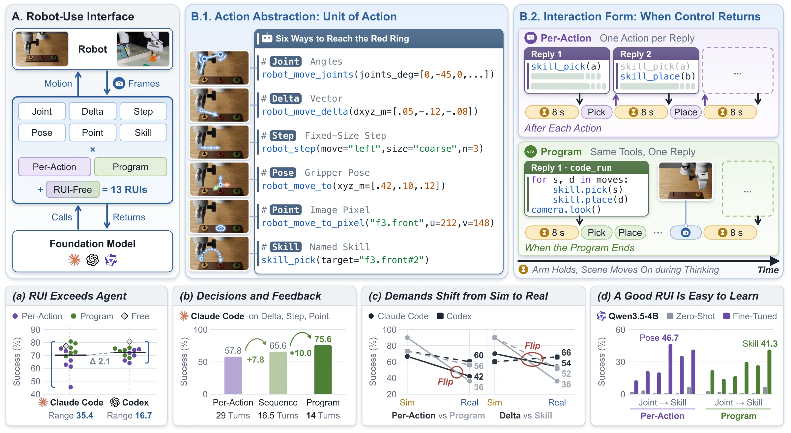
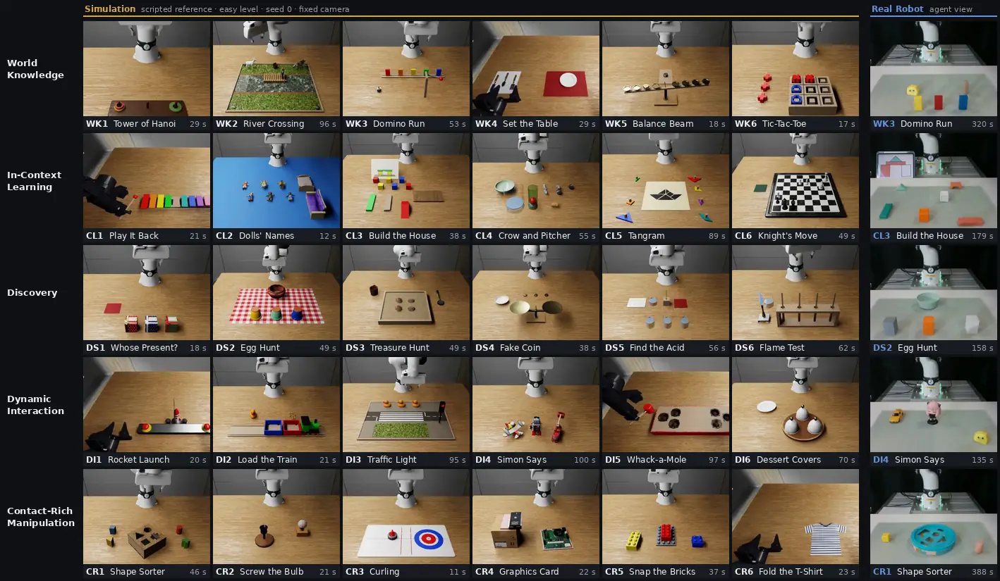
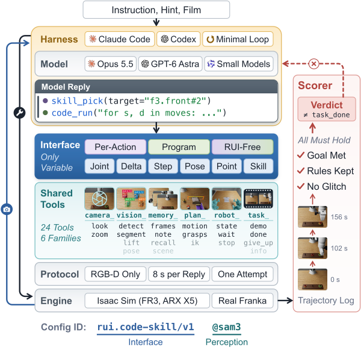
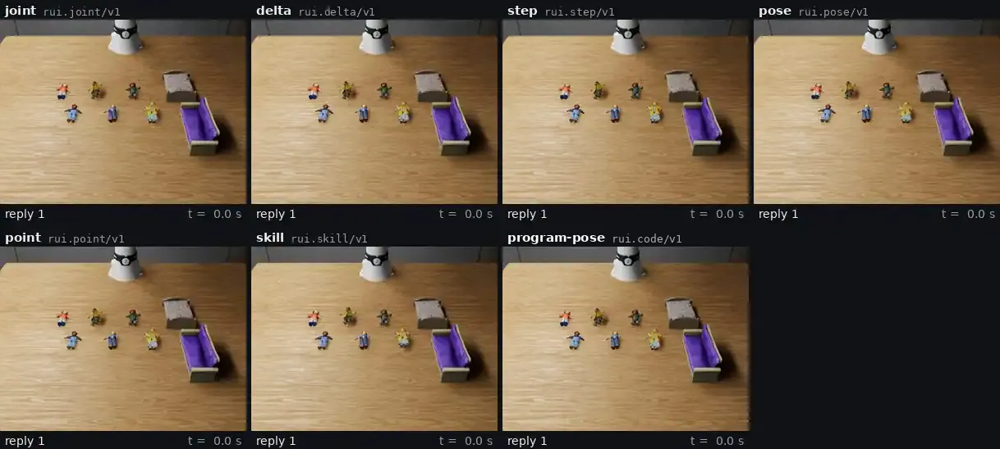
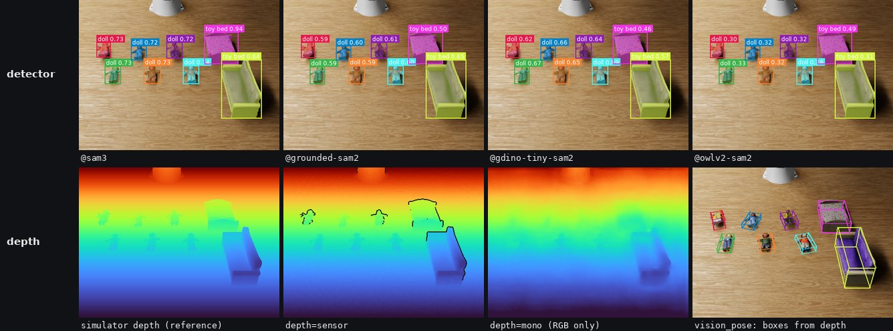
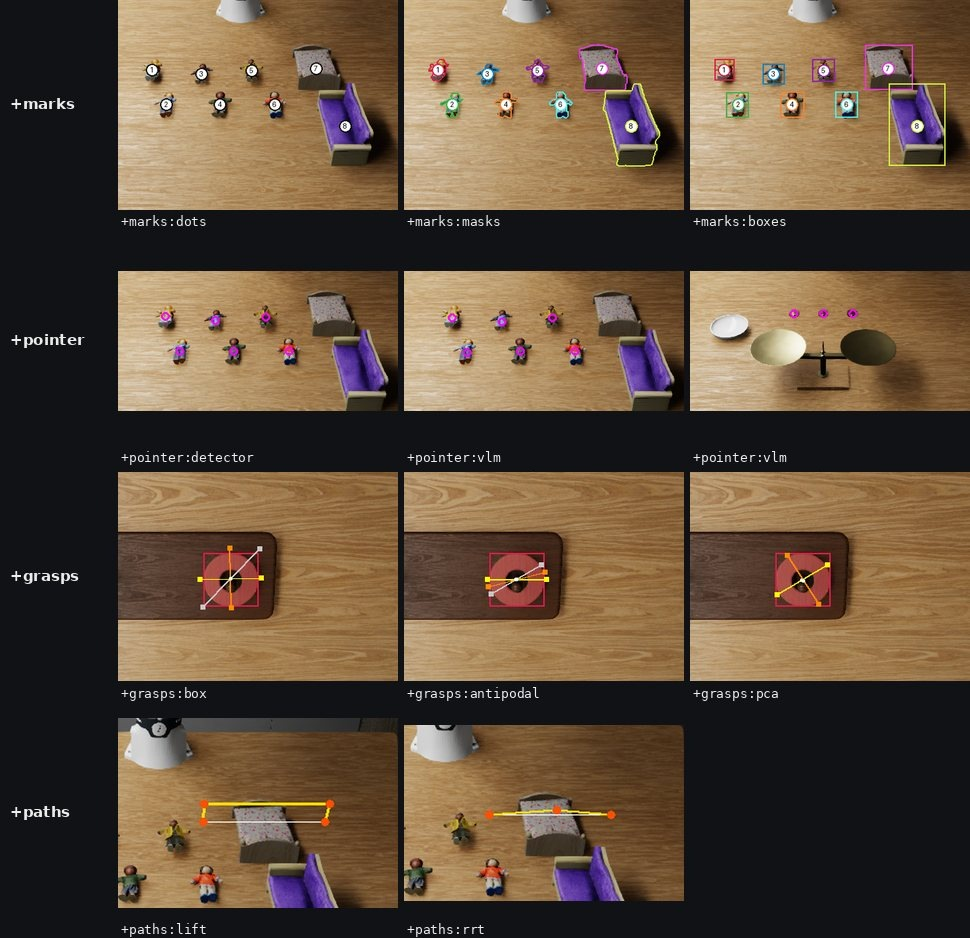

<p align="right">
  <a href="./README.md">English</a> | <b>简体中文</b>
</p>

<div align="center">


### What Makes a Good Robot-Use Interface?

<p align="center">
<a href="https://chenanno.github.io/">Yanzhe Chen</a><sup>*</sup> &middot;
<a href="https://caozhijun.top/">Zhijun Cao</a><sup>*</sup> &middot;
<a href="https://www.baizechen.site/">Zechen Bai</a><sup>*</sup> &middot;
<a href="https://wenzhengzeng.github.io/">Wenzheng Zeng</a><sup>*</sup> &middot;
<a href="https://kevinskwk.github.io/">Kevin Yuchen Ma</a> &middot;<br>
<a href="https://linyq17.github.io/">Yiqi Lin</a> &middot;
<a href="https://ethanliang99.github.io/">Guoqiang Liang</a> &middot;
<a href="https://scholar.google.com/citations?user=dAEHm8AAAAAJ&amp;hl=en">Xiaokang Liu</a> &middot;
<a href="https://skjack.github.io/">Ke Sun</a> &middot;
<a href="https://qhlin.me/">Kevin&nbsp;Qinghong&nbsp;Lin</a>&nbsp;&middot;&nbsp;<a href="https://sites.google.com/view/showlab">Mike&nbsp;Zheng&nbsp;Shou</a><sup>&dagger;</sup>
</p>

<p align="center"><b>新加坡国立大学 Show Lab</b></p>

<p align="center"><sup>*</sup> 共同第一作者 &nbsp;&middot;&nbsp; <sup>&dagger;</sup> 通讯作者</p>

<p align="center">
📄 Arxiv 论文 (即将发布) &nbsp;|&nbsp;
🤗 每日论文 (即将发布) &nbsp;|&nbsp;
🦾 <a href="https://huggingface.co/showlab/RUIBench-Qwen">模型</a> &nbsp;|&nbsp;
📊 <a href="https://huggingface.co/datasets/showlab/RUIBench-Rollouts">数据集</a> &nbsp;|&nbsp;
🌐 <a href="https://showlab.github.io/RUIBench/">主页</a>
</p>

</div>

https://github.com/user-attachments/assets/4b23e713-5db8-453e-97e2-8d5859e78448

---

## 🔥 动态

- `2026.11` RUIBench 与 RUIKit **v1.0.0** 发布，即论文实验所用的版本：30 个任务、13 种机器人操作接口，
  论文实验整理为一个计划（`ruikit run --plan paper`）。

## 📑 目录

- [🌟 概览](#-概览)
- [🧩 基准任务](#-基准任务)
- [🤖 RUIKit：13 种机器人操作接口](#-ruikit13-种机器人操作接口)
- [🚀 快速开始](#-快速开始)
- [📂 代码结构](#-代码结构)
- [📌 引用](#-引用)

## 🌟 概览

**哪种机器人操作接口更好，取决于任务需要什么。**

RUIBench 评测智能体通过不同的机器人操作接口（Robot-Use Interface，RUI）操控机器人完成任务的能力。接口规定两件事：智能体能下什么动作（关节目标、增量、固定步长、末端位姿、图像点或技能），以及动作怎样组织（每次回复一个动作，或写成一段程序）。评测统一使用机器人、控制器、时钟、感知工具和评分器，比较条件之间只改变接口。



*取自论文。机器人操作接口（RUI）决定具身 Agent 的表现。**上：** RUIKit 把六种动作抽象和两种交互形式组合成 13 种 RUI，感知和控制共用。**下：**（a）接口的选择显著影响 Agent 的成功率；（b）决策压缩与程序内反馈带来互补的提升；（c）对接口的偏好从仿真到真机发生变化；（d）针对 RUI 的微调在两种交互形式下都提升了小模型的表现。*

## 🧩 基准任务

30 个任务分为五类，每个任务有简单和困难两档。每个任务的指令都留有空白：要先想清楚，再用机械臂做出来。

| 任务类别 | 任务编号 | 要想清楚的是什么 |
|---|---|---|
| 世界知识（World Knowledge） | WK1–WK6 | 做什么：靠模型自己的知识和推理 |
| 上下文学习（In-Context Learning） | CL1–CL6 | 做什么：靠本次任务给出的材料——影片、图片、当场告知的规则 |
| 主动探索（Discovery） | DS1–DS6 | 做什么：取决于场景中隐藏的事实，要先动手去查 |
| 动态交互（Dynamic Interaction） | DI1–DI6 | 何时做：做什么是明摆着的，但场景在变、时间很紧 |
| 接触操作（Contact-Rich Manipulation） | CR1–CR6 | 怎么做：做什么是明摆着的，难在接触——插、拧、推、按、叠 |

接触操作是新增的类别，6 项任务在 v1.7 至 v1.12 间陆续建成。



*左侧：每类六个任务由脚本参考策略在仿真中完成（简单难度）；右侧：该类在真实 Franka 上的任务。单臂任务使用 Franka Research 3，五个任务使用两台 ARX X5。成败只看实际发生了什么，不看智能体怎么说。每个任务每档有 15 个开发场景和 20 个测试场景。* [docs/TASKS-zh.md](docs/TASKS-zh.md) 有每个任务的完整说明：指令、简单与困难的区别、成功条件、限制和图片。

## 🤖 RUIKit：13 种机器人操作接口

智能体只能通过 **RUIKit** 操作机器人。接口是**交互形式**作用在**动作抽象**上：六种动作抽象各配两种交互形式，构成 12 种固定 RUI；**RUI-Free** 同时提供全部。每个 RUI 有论文中的名字（使用者输入）和带版本的 id（写进 Agent 的提示词）；用名字运行时与论文一致，带辅助工具。

| 动作抽象 | 逐动作：名字 · id | 程序：名字 · id | 怎样让机械臂动 |
|---|---|---|---|
| 关节 Joint | `joint` · `rui.joint/v1` | `program-joint` · `rui.code-joint/v1` | `robot_solve_ik`（机器人自身的逆运动学）、`robot_move_joints`、`robot_gripper` |
| 增量 Delta | `delta` · `rui.delta/v1` | `program-delta` · `rui.code-delta/v1` | `robot_move_delta`（从手当前位置出发的位移和转角）、`robot_gripper` |
| 语义步 Step | `step` · `rui.step/v1` | `program-step` · `rui.code-step/v1` | `robot_step`：固定幅度的一步（平移、转动、抓取、释放） |
| 位姿 Pose | `pose` · `rui.pose/v1` | `program-pose` · `rui.code/v1` | `robot_move_to`、`robot_gripper` |
| 指点 Point | `point` · `rui.point/v1` | `program-point` · `rui.code-point/v1` | `robot_move_to_pixel`、`robot_gripper` |
| 技能 Skill | `skill` · `rui.skill/v1` | `program-skill` · `rui.code-skill/v1` | `skill_pick`、`skill_place`、`skill_press`、`skill_push`、`skill_move`、`skill_turn`、`robot_gripper` |
| 全部 | | | **RUI-Free**：`rui-free` · `rui.free/v1` |

- **逐动作：** 智能体自己调用动作抽象的工具，每次回复每只手臂一个动作。
- **程序：** 智能体用同样的工具写一段 Python 程序（`code_run`），程序结束才交回控制。论文消融另有**动作串**变体（`sequence-delta` 等），即只下动作的程序。
- **共享：** 所有 RUI 都有同样的 24 个底层工具，分六类（camera、vision、memory、plan、robot、task），只根据相机画面和机器人自身读数作答，从不读取仿真器状态。

<div align="center">



</div>

*RUIKit 总览，取自论文。对固定的 Agent 和任务，RUI 是唯一变量；Harness、24 个底层工具、评测协议和机器人后端都共用。评分器的判定不告诉 Agent。*



*CL2 简单难度，六个逐动作接口和 Program-Pose 用同一个时钟对比：Delta 和 Skill 14 秒完成，Step 需要 82 次回复，Joint 需要 72 次。*



*从像素感知：四种检测器在同一张图上（默认 `@sam3`），深度来自深度相机（`depth=sensor`）或只用 RGB 估计（`depth=mono`）。在 100 帧标注画面上，SAM 3 找到 93% 的物体，定位误差在 0.5-0.7 cm 以内；只用 RGB 时约找到 70%，误差约为三倍。*



*四种 Harness 组件，每种实现都在同一组画面上展示。组件用 `+` 接在任意接口后面（`rui.pose/v1+marks:masks`）；每种实现都是消融实验可以单独改变的一个变量。*

[docs/ruikit/](docs/ruikit/README.md)（英文）介绍各部分：感知、Harness 组件、评测条件、49 个工具，以及如何扩展。

## 🚀 快速开始

核心部分（任务卡、评分、报告、Mock 引擎、RUIKit 工具库）只需要 Python 3.10+：

```bash
pip install -e ".[dev]"
ruibench validate && ruibench demo          # 检查设计规则；在 Mock 引擎上跑全部任务
```

结果需要在 **Isaac Sim 4.5 + Isaac Lab 2.1** 的独立虚拟环境中运行（`ruibench doctor --hint` 会给出安装命令）：

```bash
pip install -e ".[isaac]"
export OMNI_KIT_ACCEPT_EULA=YES             # 阅读 NVIDIA 条款之后
ruibench setup && ruibench doctor           # 下载一次素材；检查机器
```

运行基准和 Agent。两套命令行的选项写法一致：`--task`、`--level`、`--seeds`、`--interface`、`--agent`、`--model`、`--clock`、`--engine`、`--out`。

```bash
ruibench tasks                                       # 30 个任务
ruibench run DI4 --seeds dev --out runs/ref/         # 在 Isaac 上运行脚本参考策略
ruikit interfaces                                    # 13 种 RUI 的名字和 id
ruikit episode --task CL2 --interface program-pose --model openai:<model>
ruikit run --plan paper --experiment rui --agent claude-code --model claude-opus-5-5
ruikit report runs/paper                             # 表格和结果页
```

模型通过 `openai:`、`anthropic:` 或 `local:`（vLLM 服务）访问；Claude Code 和 Codex 以各自的身份运行，每局一个全新的 Agent，只通过 MCP 操作机器人。基准冻结为 v1.0.0，即论文所用版本（`ruibench validate` 会列出任何改动过的文件）。更多：[上手指南](docs/GETTING_STARTED-zh.md)、[实验](docs/ruikit/experiments.md)、[真机](docs/REAL_ROBOT.md)、[更新记录](CHANGELOG.md)。

## 📂 代码结构

```
ruibench/   基准：任务卡及其代码、引擎（Isaac、Mock、Franka）、评分、运行器、报告
ruikit/     RUIKit：动作抽象、交互形式、感知、Harness、模型通道、实验、MCP
docs/       任务详解、上手指南、RUIKit 各部分、真机
examples/   添加工具、手动运行一局、运行一个 Agent
tests/      测试（`pytest`）
assets/     logo 和插图
```

[docs/ARCHITECTURE.md](docs/ARCHITECTURE.md) 说明模块边界和设计规则。

## 📌 引用

如果使用了 RUIBench 或 RUIKit，请引用论文：

```bibtex
@article{chen2026ruibench,
  title={Ruibench: What makes a good robot-use interface?},
  author={Chen, Yanzhe and Cao, Zhijun and Bai, Zechen and Zeng, Wenzheng and Ma, Kevin Yuchen and Lin, Yiqi and Liang, Guoqiang and Liu, Xiaokang and Sun, Ke and Lin, Kevin Qinghong and Shou, Mike Zheng},
  journal={arXiv preprint arXiv:},
  year={2026}
}
```

## 📄 许可与致谢

代码采用 Apache License 2.0，详见 `LICENSE` 和 `NOTICE`。仓库不随代码分发资产；机器人、纹理和扫描物体会下载到本机，并按各自许可使用，所涉及的 CC0 和 CC BY 4.0 许可列于 `CREDITS.md`。使用这些资产渲染的图片和视频须附相应署名信息。
