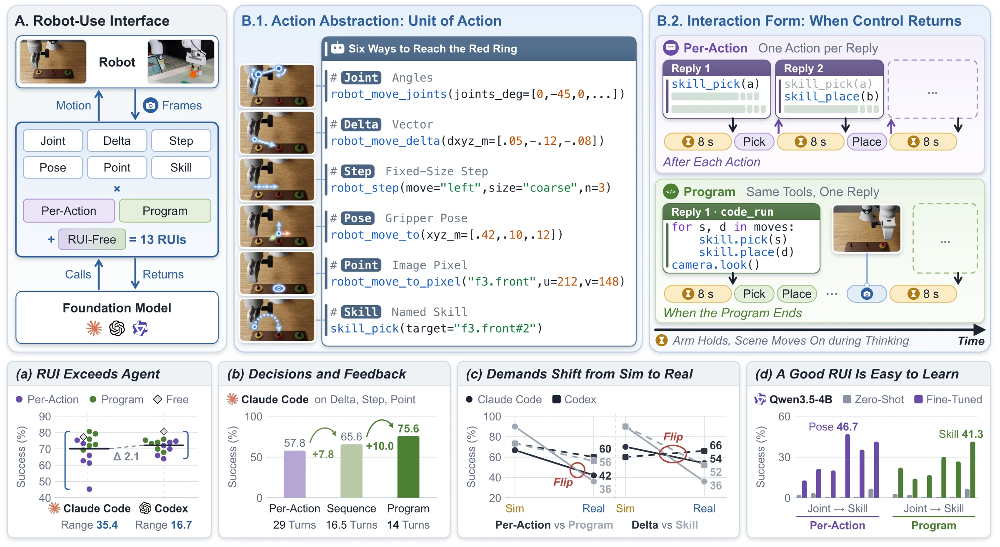
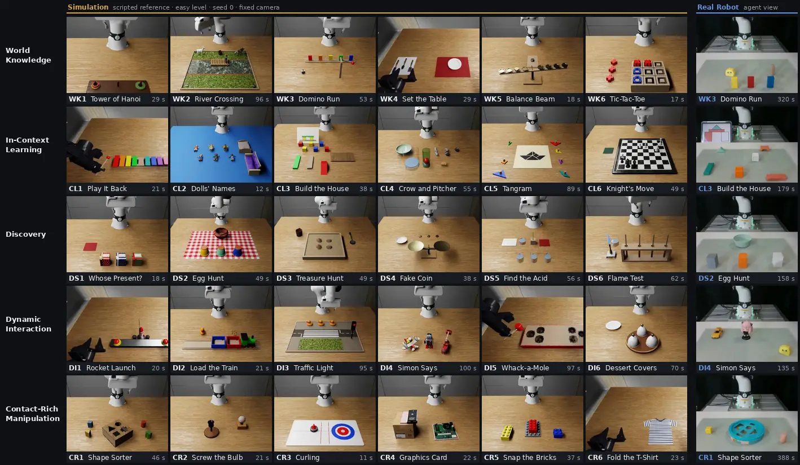
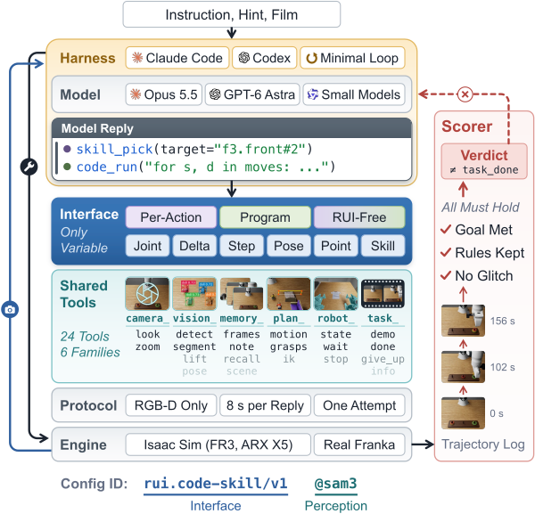
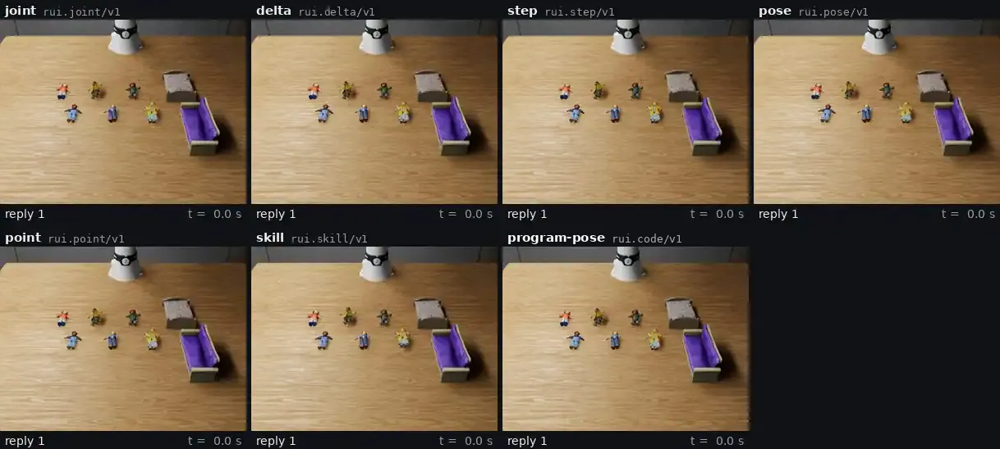
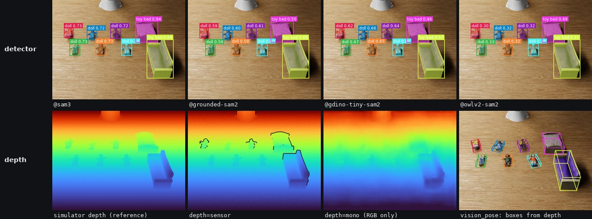
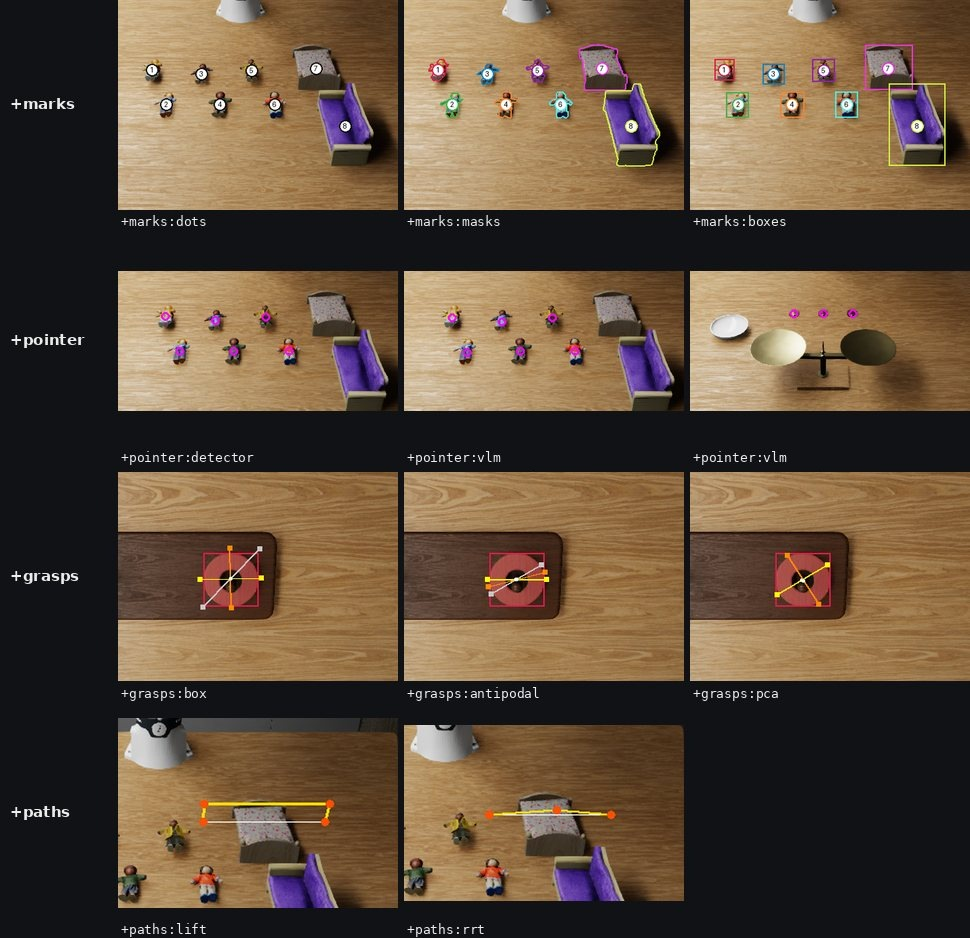

<p align="right">
  <b>English</b> | <a href="./README-zh.md">简体中文</a>
</p>

<div align="center">


### What Makes a Good Robot-Use Interface?

<p align="center">
<a href="https://chenanno.github.io/">Yanzhe Chen</a><sup>*</sup> &middot;
<a href="https://caozhijun.top/">Zhijun Cao</a><sup>*</sup> &middot;
<a href="https://www.baizechen.site/">Zechen Bai</a><sup>*</sup> &middot;
<a href="https://wenzhengzeng.github.io/">Wenzheng Zeng</a><sup>*</sup> &middot;
<a href="https://kevinskwk.github.io/">Kevin Yuchen Ma</a> &middot;<br>
<a href="https://linyq17.github.io/">Yiqi Lin</a> &middot;
<a href="https://ethanliang99.github.io/">Guoqiang Liang</a> &middot;
<a href="https://scholar.google.com/citations?user=dAEHm8AAAAAJ&amp;hl=en">Xiaokang Liu</a> &middot;
<a href="https://skjack.github.io/">Ke Sun</a> &middot;
<a href="https://qhlin.me/">Kevin&nbsp;Qinghong&nbsp;Lin</a>&nbsp;&middot;&nbsp;<a href="https://sites.google.com/view/showlab">Mike&nbsp;Zheng&nbsp;Shou</a><sup>&dagger;</sup>
</p>

<p align="center"><b>Show Lab, National University of Singapore</b></p>

<p align="center"><sup>*</sup> equal contribution &nbsp;&middot;&nbsp; <sup>&dagger;</sup> corresponding author</p>

<p align="center">
📄 <a href="https://arxiv.org/abs/2611.31115">Paper</a> &nbsp;|&nbsp;
🤗 <a href="https://huggingface.co/papers/2611.31115">Daily Paper</a> &nbsp;|&nbsp;
🦾 <a href="https://huggingface.co/showlab/RUIBench-Qwen">HF Models</a> &nbsp;|&nbsp;
📊 <a href="https://huggingface.co/datasets/showlab/RUIBench-Rollouts">HF Dataset</a> &nbsp;|&nbsp;
🌐 <a href="https://showlab.github.io/RUIBench/">Project Page</a>
</p>

</div>

https://github.com/user-attachments/assets/4b23e713-5db8-453e-97e2-8d5859e78448

---

## 🔥 News

- `2026.11` RUIBench and RUIKit **v1.0.0**, the version the paper's experiments ran on: 30 tasks,
  13 robot-use interfaces, and the paper's experiments as one plan (`ruikit run --plan paper`).

## 📑 Contents

- [🌟 Overview](#-overview)
- [🧩 The benchmark](#-the-benchmark)
- [🤖 RUIKit: 13 robot-use interfaces](#-ruikit-13-robot-use-interfaces)
- [🚀 Quick start](#-quick-start)
- [📂 Repository layout](#-repository-layout)
- [📌 Citation](#-citation)

## 🌟 Overview

**Which Robot-Use Interface is best depends on what the task requires.**

RUIBench measures agents driving robots through different *Robot-Use Interfaces* (RUIs): what an
agent can command -- joint targets, deltas, fixed steps, gripper poses, image points or skills --
and how those actions are organized, one per reply or composed in a program. The robot, its
controller, the clock, the perception tools and the scorer are shared; the only thing that changes
between conditions is the interface.



*From the paper. Robot-use interfaces (RUIs) shape embodied agent performance. **Top:** RUIKit organizes six action
abstractions and two interaction forms into 13 RUIs under shared perception and control. **Bottom:** (a) interface
choice substantially affects agent success; (b) decision compression and in-program feedback provide complementary
gains; (c) interface preferences shift from simulation to reality; (d) RUI-specific fine-tuning improves
small-model performance in both interaction forms.*

## 🧩 The benchmark

30 tasks in five suites, each at an easy and a hard level. Every task leaves something out of its
instruction: it has to be thought out, and then done with the arm.

| Suite | Tasks | What has to be thought out |
|---|---|---|
| World knowledge | WK1-WK6 | what to do, from the model's own knowledge and reasoning |
| In-context learning | CL1-CL6 | what to do, from what the episode gives: a film, a picture, a rule told on the spot |
| Discovery | DS1-DS6 | what to do, from a fact hidden in the scene that has to be found by acting |
| Dynamic interaction | DI1-DI6 | when to do it: what to do is plain, the scene changes and time is short |
| Contact-rich manipulation | CR1-CR6 | how to do it: what to do is plain, and the difficulty is in the contact -- fitting, screwing, pushing, pressing, folding |



*Each suite's six tasks done by the scripted reference in simulation (easy), and on the right its
task on the real Franka. Single-arm tasks use a Franka Research 3; five use two ARX X5 arms. Success
is judged from what physically happened, never from what the agent says. Each task has 15
development and 20 test missions per level.* [docs/TASKS.md](docs/TASKS.md) has every task in
full: the instruction, what changes from easy to hard, success, limits and pictures.

## 🤖 RUIKit: 13 robot-use interfaces

An agent acts on the robot only through **RUIKit**. An interface is an **interaction form** applied
to an **action abstraction**; six abstractions in two forms make 12 fixed RUIs, and **RUI-Free**
offers all of them at once. Each RUI has the paper's name, which you type, and a versioned id,
which the agent reads; a name runs it with the aids, as the paper did.

| Abstraction | Per-action: name · id | Program: name · id | How it moves the arm |
|---|---|---|---|
| Joint | `joint` · `rui.joint/v1` | `program-joint` · `rui.code-joint/v1` | `robot_solve_ik` (the robot's own inverse kinematics), `robot_move_joints`, `robot_gripper` |
| Delta | `delta` · `rui.delta/v1` | `program-delta` · `rui.code-delta/v1` | `robot_move_delta` (a move and a turn from where the hand is), `robot_gripper` |
| Step | `step` · `rui.step/v1` | `program-step` · `rui.code-step/v1` | `robot_step`: one fixed-size step (a direction, a turn, grasp, release) |
| Pose | `pose` · `rui.pose/v1` | `program-pose` · `rui.code/v1` | `robot_move_to`, `robot_gripper` |
| Point | `point` · `rui.point/v1` | `program-point` · `rui.code-point/v1` | `robot_move_to_pixel`, `robot_gripper` |
| Skill | `skill` · `rui.skill/v1` | `program-skill` · `rui.code-skill/v1` | `skill_pick`, `skill_place`, `skill_press`, `skill_push`, `skill_move`, `skill_turn`, `robot_gripper` |
| all of them | | | **RUI-Free**: `rui-free` · `rui.free/v1` |

- **Per-action:** the agent calls the abstraction's tools itself, one action per arm per reply.
- **Program:** the agent writes a Python program over the same tools (`code_run`); control comes
  back when the program ends. The paper's ablation adds an **action-sequence** variant
  (`sequence-delta`, ...), a program that only acts.
- **Shared:** every RUI offers the same 24 underlying tools in six families (camera, vision,
  memory, plan, robot, task), answering from the cameras and the robot's own readings, never the
  simulator's state.

<div align="center">



</div>

*Overview of RUIKit, from the paper. The RUI is the only variable for a fixed agent and task, while the harness,
24 underlying tools, evaluation protocol, and robot backend remain shared. The scorer's verdict is withheld from the
agent.*



*CL2 easy through each per-action interface and Program-Pose, on one clock: Delta and Skill finish in 14 s, Step takes
82 replies, Joint 72.*



*Perception from pixels: the four detectors on one picture (`@sam3` is the default), and depth from the camera
(`depth=sensor`) or from the RGB alone (`depth=mono`). Over 100 marked frames, SAM 3 finds 93% of the things and places
them within 0.5-0.7 cm; from the RGB alone about 70% are found, with about three times the error.*



*Four of the Harness components, each implementation on the same pictures. A component attaches to any interface after
a `+` (`rui.pose/v1+marks:masks`); each implementation is a variable an ablation can change on its own.*

[docs/ruikit/](docs/ruikit/README.md) describes the parts -- perception, Harness components, conditions, the 49 tools --
and how to add one.

## 🚀 Quick start

The core (task cards, scoring, reports, the mock engine, RUIKit's tools) needs only Python 3.10+:

```bash
pip install -e ".[dev]"
ruibench validate && ruibench demo          # the design rules; every task on the mock engine
```

Results come from **Isaac Sim 4.5 + Isaac Lab 2.1**, in their own virtualenv
(`ruibench doctor --hint` prints the commands):

```bash
pip install -e ".[isaac]"
export OMNI_KIT_ACCEPT_EULA=YES             # after reading NVIDIA's terms
ruibench setup && ruibench doctor           # fetch the assets once; check the machine
```

Run the benchmark and an agent. Both command lines spell their options alike: `--task`, `--level`,
`--seeds`, `--interface`, `--agent`, `--model`, `--clock`, `--engine`, `--out`.

```bash
ruibench tasks                                       # the 30 tasks
ruibench run DI4 --seeds dev --out runs/ref/         # the scripted reference on Isaac
ruikit interfaces                                    # the 13 RUIs, by name and id
ruikit episode --task CL2 --interface program-pose --model openai:<model>
ruikit run --plan paper --experiment rui --agent claude-code --model claude-opus-5-5
ruikit report runs/paper                             # the tables and the results page
```

Models are reached through `openai:`, `anthropic:` or `local:` (a vLLM server); Claude Code and
Codex run as themselves, one fresh agent an episode over MCP. The benchmark is frozen as v1.0.0,
the paper's version (`ruibench validate` names any file that differs). More:
[getting started](docs/GETTING_STARTED.md), [experiments](docs/ruikit/experiments.md),
[the real robot](docs/REAL_ROBOT.md), [changes](CHANGELOG.md).

## 📂 Repository layout

```
ruibench/   the benchmark: task cards and their code, engines (Isaac, mock, Franka), scoring, runner, reports
ruikit/     RUIKit: action abstractions, interaction forms, perception, harnesses, models, experiments, MCP
docs/       the tasks in full, getting started, RUIKit's parts, the real robot
examples/   adding a tool, an episode by hand, running an agent
tests/      the test suite (`pytest`)
assets/     the logo and the figures
```

[docs/ARCHITECTURE.md](docs/ARCHITECTURE.md) explains the boundaries and the design rules.

## 📌 Citation

If you use RUIBench or RUIKit, please cite the paper:

```bibtex
@article{chen2026ruibench,
  title={Ruibench: What makes a good robot-use interface?},
  author={Chen, Yanzhe and Cao, Zhijun and Bai, Zechen and Zeng, Wenzheng and Ma, Kevin Yuchen and Lin, Yiqi and Liang, Guoqiang and Liu, Xiaokang and Sun, Ke and Lin, Kevin Qinghong and Shou, Mike Zheng},
  journal={arXiv preprint arXiv:2611.31115},
  year={2026}
}
```

## 📄 Licence and credits

The code is under the Apache License 2.0 (`LICENSE`, `NOTICE`). No asset is
distributed with it: robots, textures and scanned objects are fetched on your
machine and used under their own licences -- CC0 and CC BY 4.0 -- listed in
`CREDITS.md`. Pictures and videos rendered with them must carry that credit.
