# RUIBench：任务详解

[English](TASKS.md) | 中文

[README](../README-zh.md) 给出了概览和任务总表。本页补充其余内容：所有任务运行共用的设置、任务场景及数据划分的生成方式，以及每项任务的详细说明和图片。

> 文中的指令和提示均为译文，智能体实际收到的是英文原文，见 [TASKS.md](TASKS.md)。

## 30 个任务一览

每个任务的简单和困难难度由一个声明的旋钮区分，任务卡里列出随它一起变化的内容。

| 任务 | 机械臂数 | 任务要求 | 简单 → 困难 |
|---|---|---|---|
| WK1 Tower of Hanoi | 1 | 按规则将塔移到最右侧柱子 | 3 步 → 从中途局面开始，7–11 步 |
| WK2 River Crossing | 1 | 用木筏将狼、羊和水桶（或卷心菜）运到对岸 | 1 组不能独处的组合 → 2 组 |
| WK3 Domino Run | 1 | 摆好 5 块骨牌，让摆锤通过骨牌连锁反应敲响铃铛 | 直线 → 转角 |
| WK4 Set the Table | 2 | 为桌子对面的客人摆好餐具 | 1 个餐位 → 2 个 |
| WK5 Balance Beam | 1 | 用托盘上的砝码使横梁保持水平 | 1 个砝码 → 2 个 |
| WK6 Tic-Tac-Toe | 1 | 执 X，从中途局面赢得比赛 | 已有制胜机会 → 等待对手唯一一次失误 |
| CL1 Play It Back | 2 | 在玩具木琴上演奏视频中的旋律 | 木琴布局相同 → 琴键重排，含和弦 |
| CL2 Dolls' Names | 1 | 根据视频中介绍的名字，将 Momo 放到床上 | 1 个名字 → 2 个 |
| CL3 Build the House | 1 | 按卡片上的图样搭房子 | 3 块积木 → 7 块 |
| CL4 Crow and Pitcher | 1 | 取出罐中漂浮但够不到的小球 | 4 颗石子 → 8 颗 |
| CL5 Tangram | 1 | 根据另一张图的完成示例，完成当前卡片 | 标出各块轮廓 → 仅给出整体剪影 |
| CL6 Knight's Move | 1 | 按提示中的规则移动骑士，吃掉国王 | 4 步 → 6 步 |
| DS1 Whose Present? | 1 | 将 Tom 的礼物放到红色垫子上 | 3 份礼物，名字朝上 → 5 份，名字朝下 |
| DS2 Egg Hunt | 1 | 找到彩蛋并放入篮子 | 藏在 3 个盆下 → 藏在 2 个盆或 2 个盒子中 |
| DS3 Treasure Hunt | 1 | 用玩具金属探测器找到硬币，只能掀开 1 个贝壳 | 4 个贝壳 → 9 个 |
| DS4 Fake Coin | 1 | 用玩具天平找出较轻的硬币 | 3 枚硬币 → 9 枚 |
| DS5 Find the Acid | 1 | 用 pH 试纸找出酸性溶液（以及碱性溶液） | 3 个烧杯 → 5 个烧杯、4 张试纸 |
| DS6 Flame Test | 1 | 使火焰呈现指定颜色：4 根浸过盐溶液的木条里哪根烧出什么颜色，只有伸进火焰才知道 | 绿色 → 先红色、再绿色 |
| DI2 Load the Train | 1 | 将泰迪熊和小鸭放入行驶中的火车车厢 | 慢速 → 快速 |
| DI3 Traffic Light | 1 | 趁绿灯将 3 只小鸭送过马路 | 绿灯时间长 → 短 |
| DI4 Simon Says | 1 | 只执行带有“Simon 说”的指令 | 4 条指令 → 6 条，间隔更短 |
| DI5 Whack-a-Mole | 2 | 用手中的锤子击打地鼠 | 每次出现 1 只 → 两侧同时出现 |
| DI6 Dessert Covers | 1 | 观察转盘运动，再找出蛋糕所在的罩子 | 慢转 1 圈 → 快转 3 圈 |
| DI1 Rocket Launch | 2 | 操作双按钮控制台发射火箭 | 按下后保持的按钮 → 松手即回弹的按钮 |
| CR1 Shape Sorter | 1 | 把每块积木从自己形状的孔放进盒子 | 孔的余量 6 毫米 → 2 毫米 |
| CR2 Screw the Bulb | 1 | 把灯泡拧进台灯，拧到灯亮 | 拧四分之一圈 → 拧两圈 |
| CR3 Curling | 1 | 只推不抓，把冰壶推进大本营 | 进大本营（9 厘米）→ 盖住中心白圆（1.5 厘米） |
| CR4 Graphics Card | 1 | 把显卡插进主板的白色长插槽并压到底 | 槽口每侧余量 3 毫米 → 1 毫米 |
| CR5 Snap the Bricks | 1 | 把大颗粒积木一块块按到位，拼成一座塔 | 要拼 2 块 → 4 块 |
| CR6 Fold the T-Shirt | 2 | 把平铺的 T 恤叠起来：下摆折到肩上 | 折 1 下 → 折 3 下（先把两只袖子折进来） |

## 公共设置

- **机器人与相机。** 单臂任务：桌边一台 Franka Research 3，桌对面一台固定相机（512 × 512），以及一台腕部相机——安装在手部后方支架上的 RealSense D405，能看到手指张开或闭合，以及手中拿着什么。双臂任务（WK4、CL1、DI1、DI5、CR6）：两条 ARX X5 机械臂，按 RoboDojo 工作站布置，两臂之间设头部相机（640 × 480，向下倾斜 60 度），每条臂各有一台腕部相机。
- **仿真器。** 结果来自 Isaac Sim 4.5 与 Isaac Lab 2.1，使用 RTX 渲染：受测模型从未在这些图像上微调过，因此渲染出的画面*就是*观测。Mock 引擎没有物理、也不渲染像素，运行相同的任务，用于测试和开发任务逻辑，从不产出正式结果。
- **智能体获知的信息。** 任务指令；部分任务另有提示（人类遥操作机器人时同样会被告知的内容，如游戏规则、玩具的玩法）；四项上下文学习任务（CL1、CL2、CL4、CL5）在开始前播放一到两段视频。其余一切都须通过接口工具，从相机和机械臂读数中获取——带有与真实机器人相当的感知误差，且永远拿不到仿真器状态、物体的内部名称、随机种子或评分器。
- **动作方式。** 通过一种接口，即 RUIKit 的 13 种 RUI 之一：一种动作抽象（Joint、Delta、Step、Pose、Point 或 Skill）配一种交互形式（逐动作或程序），或同时提供全部的 RUI-Free（见 README 中的[Robot Agent 与 RUIKit](../README-zh.md#-ruikit13-种机器人操作接口)）。所有接口驱动同一个控制器。
- **时间。** 模型思考时，环境持续运行：主设置下，每次回复对所有模型都推进 8 秒仿真时间（`--clock 8s`）；在实测时钟下，按模型实际回复所用的时间推进（等待 API 的时间不计入）。限时任务（DI1–DI6）以 `T_ref` 表述速度，取值 8 秒，依据三个模型实测的回复时间确定。
- **限制。** 每项任务的每个难度都有轮数预算（30 至 1,296 个模型轮次，每轮十次回复；各任务的数值见下文），以及仿真时间上限，即轮数乘以 `T_ref`，最多 30 分钟。达到目标并不会结束一局：Agent 调用 `task_done` 或 `task_give_up`，或达到任一限制，一局才结束，并按此时的场景判定（若一达到目标就结束，等于告诉 Agent 已经成功）。
- **成功判定。** 由基准依据实际发生的物理过程判定，而非智能体的报告；也可离线依据日志重新判定（`ruibench rescore`）。里程碑用于衡量部分进展。物理审计会标记任何物理上不会发生的情况（瞬移、抛掷、关节超出限位）；被标记的任务在有人复核之前判为失败。

## 任务场景与数据划分

- **任务场景。** 随机种子决定一次任务的布置：每样东西放在哪里、朝向如何，哪份礼物是 Tom 的（DS1），彩蛋藏在哪个盆下（DS2），困难难度的汉诺塔从哪个局面开始（WK1）。同一种子在任何机器上都生成相同的场景。只有 CL2 的指令随种子变化（玩偶的名字）。
- **数据划分。** `ruibench/tasks/splits.json` 为每项任务的每个难度分配场景：**15 个用于开发，20 个用于测试，5 个备用**。种子从 0 开始依次选取，只保留同时满足以下两点的种子：布局通过 `ruibench validate` 的几何检查（可达、在固定相机视野内、未被其他物体或机械臂遮挡、可抓取、手部路径无阻挡），且脚本参考策略在 Isaac 上成功完成（每次完整扫描都会运行所有任务难度的种子 0–24）。
- **当前情况。** 每项任务的每个难度都以种子 0–14 作开发集、15–34 作测试集、35–39 作备用——CL2 困难难度除外：其参考策略在种子 1、7、9、10、12、14 和 22 上失败（玩偶从沙发上弹落），因此它的 40 个场景取自种子 0–46。论文的表格使用简单难度和每项任务的第一个测试种子（15）。
- **规模。** 一个模型通过一种接口，在 30 项任务（60 种任务与难度组合）上：900 次开发任务运行（60 × 15）和 1,200 次测试任务运行（60 × 20）；通过全部 13 种 RUI 则分别为 11,700 和 15,600 次。论文主表为 30 项任务 × 13 种 RUI × 1 个测试种子，即每个 Agent 390 局。在 Isaac 上，一次模型任务运行约需 5–20 分钟。
- **任务角色。** 每类任务中有一项是*开发任务*（WK1、CL3、DS2、DI4、CR1），用于调整提示词、难度和评分器，它仍保留在榜单中。每类任务还保留一个*留出模板*，已完成设计，但刻意不实现（WK7、CL7、DS7、DI7、CR7）。
- `ruibench seeds DS1 easy` 打印该任务难度的开发种子。划分很早就已冻结，已有任务的划分此后保持不变（新任务建成时并入它的种子）；基准冻结为 **v1.0.0**，即论文所用版本。`ruibench freeze` 为所有影响任务运行的文件——任务卡及其代码、评分、Isaac 引擎（不含 Mock 引擎，它从不产出正式结果）、RUIKit 的接口和工具——以及 `T_ref` 生成指纹。修改其中任何一项都会使该版本的测试结果失效；`ruibench validate` 和 `ruibench freeze --check` 会列出变更，且划分不能再重新生成。值得保留的改动会形成新版本（`ruibench freeze <版本> --again`）；结果只在同一版本内可比。

## 逐项任务说明

每条图带取自展示录像中的固定相机画面（种子 0）：脚本参考策略在一个简单场景和一个困难场景的开始与结束时刻；上下文学习任务在此之前还有一帧预先展示的视频。包含腕部相机画面和指令的视频见展示页面：`ruibench showcase` 负责录制，`ruibench serve` 提供访问（本机地址为 http://localhost:8765/showcase/index.html）。“指令”为种子 0 的指令。

### 世界知识（World knowledge，WK）

*做什么，靠模型自己的知识和推理；桌上没有任何东西会给出答案。*

**WK1 Tower of Hanoi（汉诺塔）** · 单臂（FR3） · 开发任务

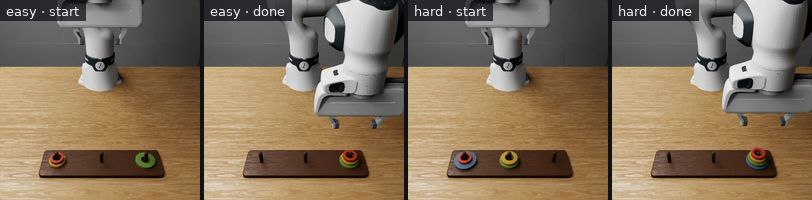

- **指令（种子 0）：** *“解汉诺塔：把塔移到右边的柱子上（以前置相机画面中的左右为准）。”*
- **提示：** *“只能拿柱子最上面的圆环，且圆环永远不能放到比它小的圆环上。”*
- **缺失信息：** 走法：规则人人都知道，解法要自己推出来
- **简单 → 困难：** 局面：三个圆环，最大的已在目标柱上（3 步）→ 四个圆环，从进行中的局面开始，按种子从所有距终局 7 到 11 步的局面中抽取
- **成功条件：** 所有圆环都在右侧柱上、最大的在底部，静止 2 秒，且每一步都合法（一次一个圆环、只拿最上面的、圆环只放在柱子上、从不放在更小的圆环上）；既看手里拿着什么，也看圆环实际在哪里
- **运行限制：** 120 轮，仿真时间 16 分钟（两种难度相同）
- **Isaac 上的脚本参考策略（种子 0–24）：** 简单 25/25，用时 26 秒 · 困难 25/25，用时 82 秒

**WK2 River Crossing（渡河）** · 单臂（FR3）

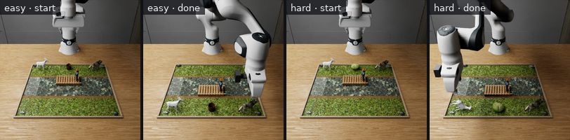

- **指令（种子 0）：** 简单 *“把狼、羊和水桶运到对岸。木筏能载农夫和另外一样东西。永远不要让狼和羊单独待在一起。”* · 困难 *“把狼、羊和卷心菜运到对岸。木筏能载农夫和另外一样东西。永远不要让羊单独和狼或卷心菜待在一起。”*
- **提示：** *“把乘客抬到木筏上即可带它过河——它上筏且手离开后，木筏会载着农夫和它驶向对岸。若要让木筏空载过河，轻敲它的甲板。”*
- **缺失信息：** 过河的顺序（经典谜题：羊要被带回来一次）
- **简单 → 困难：** 需遵守的规则：狼与羊；或经典的两条（羊与狼、羊与卷心菜），需要把羊带回来一次
- **成功条件：** 三者都在对岸且静止；在此之前，木筏不在的那一岸从未出现禁止的组合，没有东西被放进水里，也没有东西不经木筏换岸：只在木筏靠岸时从所在的这一岸放上木筏，只在木筏到达的那一岸卸下
- **运行限制：** 120 轮，仿真时间 16 分钟（两种难度相同）
- **Isaac 上的脚本参考策略（种子 0–24）：** 简单 25/25，用时 93 秒 · 困难 25/25，用时 145 秒

**WK3 Domino Run（多米诺骨牌）** · 单臂（FR3）

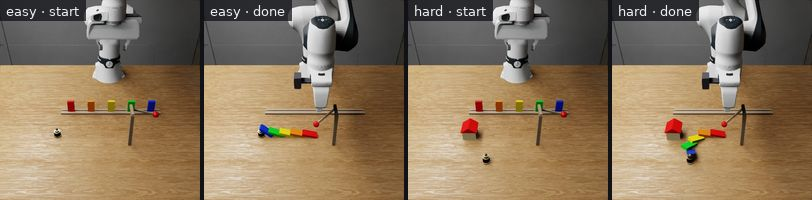

- **指令（种子 0）：** *“摆好多米诺骨牌，让摆锤敲响铃铛。你说完成后，摆锤就会被放开。”*
- **缺失信息：** 骨牌要怎样立才能连锁倒下，以及何时算准备就绪
- **简单 → 困难：** 路线：铃铛在摆锤正前方 → 铃铛在拐角处、一座玩具房子后面，骨牌链必须转弯
- **成功条件：** 手中没有骨牌、铃铛上也没有倒着的骨牌时放开摆锤，随后铃铛被放开摆锤时还立着的骨牌敲响
- **运行限制：** 60 轮，仿真时间 8 分钟（两种难度相同）
- **Isaac 上的脚本参考策略（种子 0–24）：** 简单 25/25，用时 53 秒 · 困难 25/25，用时 52 秒

**WK4 Set the Table（摆餐桌）** · 双臂（ARX X5）

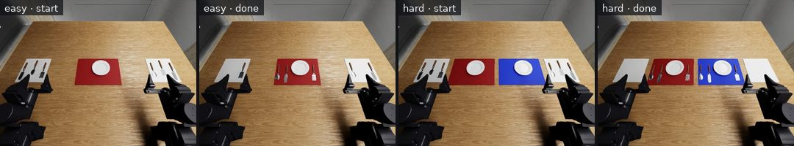

- **指令（种子 0）：** 简单 *“为你对面的客人摆好餐具。”* · 困难 *“为你对面的两位客人摆好餐具。”*
- **提示：** *“每条臂只能够到桌子上它自己那一侧。”*
- **缺失信息：** 一个餐位上叉子、刀和勺子各放在哪里
- **简单 → 困难：** 要摆的餐位，每个三件：一位客人在正对面——叉子在右臂一侧，其余在左臂一侧 → 两位客人并排，每条臂负责一个餐位
- **成功条件：** 每个餐位都已摆好，按左右和顺序判定：餐具平放在该餐位的餐垫上、与盘子齐平；从客人一侧看，叉子在盘子左边，刀在盘子右边，勺子在刀的外侧（从机器人一侧看左右镜像）；刀那一侧没有叉子，叉子那一侧没有刀或勺子；所有物品静止 1.5 秒
- **运行限制：** 90 轮，仿真时间 12 分钟（两种难度相同）
- **Isaac 上的脚本参考策略（种子 0–24）：** 简单 25/25，用时 22 秒 · 困难 25/25，用时 34 秒

**WK5 Balance Beam（平衡木）** · 单臂（FR3）

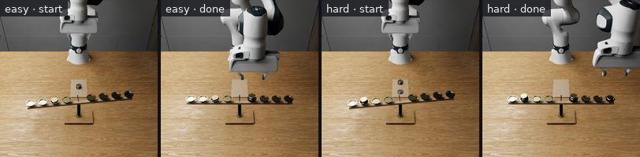

- **指令（种子 0）：** *“用托盘上的所有东西让横梁保持水平。上面已有的东西不要动。”*
- **提示：** *“铜砝码重量都相同，每个算一份；两个叠在一起就是两份。每侧的秤盘距支点分别为 1、2、3、4 格。托盘上的每个砝码只能放一次——在秤盘里松手之后，就不能再拿起来。”*
- **缺失信息：** 杠杆原理——砝码离支点远一倍，拉力也大一倍；横梁上没有任何东西说明这一点
- **简单 → 困难：** 横梁上的问题：第 2 格有一个单份砝码，需用一个双份砝码（放在第 1 格）来平衡 → 第 3 格有一个双份砝码，需用一个双份和一个单份砝码来平衡，每个秤盘放一个（双份放第 1 格，单份放第 4 格）
- **成功条件：** 横梁保持水平 2 秒，托盘上的每个砝码都在右侧的秤盘里，左侧原有的砝码仍在原处，且没有哪个砝码在秤盘里松手后又被拿起或移到别的秤盘
- **运行限制：** 60 轮，仿真时间 8 分钟（两种难度相同）
- **Isaac 上的脚本参考策略（种子 0–24）：** 简单 25/25，用时 13 秒 · 困难 25/25，用时 27 秒

**WK6 Tic-Tac-Toe（井字棋）** · 单臂（FR3）

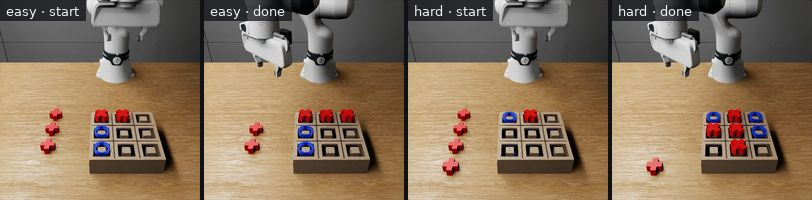

- **指令（种子 0）：** *“你是 X。赢下这局。”*
- **提示：** *“把一枚 X 棋子放进空格即为落子。你的手离开棋盘后，对手的 O 棋子会自己从棋盘里升起来——有棋子升起时，手不要停在棋盘上方；棋局结束时对手会宣布。”*
- **缺失信息：** 对手的下一步
- **简单 → 困难：** 胜机从何而来：就在棋盘上（X 有一步制胜棋，O 没有威胁）→ 对手的一次失误（棋盘上已有一个 X 和一个 O，双方都不犯错时为和棋；O 会在第一次或第二次应对时犯一次错，按种子抽取，X 只有通过双杀才能获胜）
- **成功条件：** X 连成三子，每回合只下一枚 X，没有 X 放到已被占的格子上，已放下的 X 没有被移动，且 O 升起时手不在棋盘上方——犯规只算到对局结束为止
- **运行限制：** 40 轮，仿真时间 5 分钟（两种难度相同）
- **Isaac 上的脚本参考策略（种子 0–24）：** 简单 25/25，用时 11 秒 · 困难 25/25，用时 40 秒

### 上下文学习（In-context learning，CL）

*做什么，靠本次任务给出的材料：影片、图片、当场告知的规则。*

**CL1 Play It Back（复现旋律）** · 双臂（ARX X5）

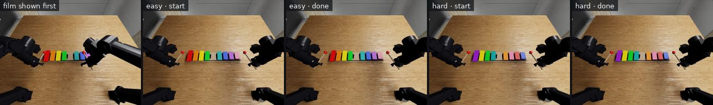

- **指令（种子 0）：** *“演奏视频里的曲子。”*
- **提示：** *“琴槌头从上方敲到琴键时，琴键会发声。左臂演奏左侧的琴键，右臂演奏右侧的琴键。”*
- **预先展示：** 1 段视频——“机器人演奏一段曲子。”
- **缺失信息：** 曲子本身：只出现在视频中，从不以文字给出
- **简单 → 困难：** 木琴和曲子：与视频中相同的木琴，五个音，双手轮流 → 琴键颜色换成另一种排列（没有琴键保持原来的颜色），且五步中有两步是和弦，即双手各敲一个琴键、同时敲下（间隔不超过 0.4 秒）
- **成功条件：** 按颜色依次奏出视频中的每一步（和弦的两个琴键间隔不超过 0.4 秒），且没有敲其他琴键
- **运行限制：** 40 轮，仿真时间 5 分钟（两种难度相同）
- **Isaac 上的脚本参考策略（种子 0–24）：** 简单 25/25，用时 15 秒 · 困难 25/25，用时 16 秒

**CL2 Dolls' Names（玩偶的名字）** · 单臂（FR3）

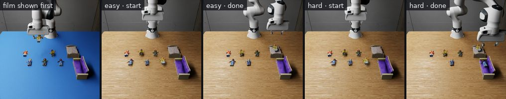

- **指令（种子 0）：** 简单 *“把 Nono 放到床上睡觉。”* · 困难 *“把 Nono 放到床上睡觉，把 Pipa 放到沙发上。”*
- **预先展示：** 2 段视频——“这是 Nono。”；“这是 Pipa。”
- **缺失信息：** 名字对应哪个玩偶：视频只介绍一次
- **简单 → 困难：** 要学的新名字：Momo，或 Momo 和 Kiki（各自放到自己的位置）
- **成功条件：** 被点名的玩偶静止在床上（困难难度下，第二个玩偶静止在沙发上），没有移动其他玩偶，也从未把玩偶放到不该放的地方
- **运行限制：** 简单 30 轮、4 分钟 · 困难 45 轮、6 分钟
- **Isaac 上的脚本参考策略（种子 0–24）：** 简单 25/25，用时 9 秒 · 困难 18/25，用时 19 秒；未纳入划分的种子：1、7、9、10、12、14、22

**CL3 Build the House（搭房子）** · 单臂（FR3） · 开发任务

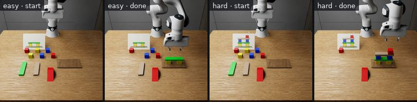

- **指令（种子 0）：** *“按卡片上的样子，在木板上搭出房子。”*
- **缺失信息：** 搭什么、按什么顺序搭：只画在卡片上
- **简单 → 困难：** 卡片上房子用到的积木：一道门（两个立方体和一块木板）→ 一个门洞及其门楣、带平顶的第二层，以及第三种颜色的烟囱
- **成功条件：** 卡片上的每块积木都按卡片上的相对位置立好，房子放在木板上哪里都行；木板上没有其他东西，且房子静止 3 秒
- **运行限制：** 60 轮，仿真时间 8 分钟（两种难度相同）
- **Isaac 上的脚本参考策略（种子 0–24）：** 简单 25/25，用时 33 秒 · 困难 25/25，用时 78 秒

**CL4 Crow and Pitcher（乌鸦喝水）** · 单臂（FR3）

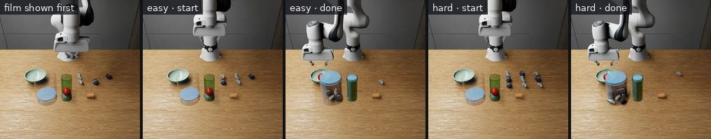

- **指令（种子 0）：** *“把球从罐子里取出来，放进碟子里。”*
- **预先展示：** 2 段视频——“一块石头掉进井里。”；“一个软木塞掉进井里。”
- **缺失信息：** 方法：视频只展示石头和软木塞掉进井里会怎样，并没有说明如何拿到球——把两者联系起来要靠智能体自己；直接伸手去拿球，无论手伸到哪里都会失败
- **简单 → 困难：** 四块石头 → 八块，方法相同
- **成功条件：** 球在碟子里
- **运行限制：** 简单 110 轮、15 分钟 · 困难 166 轮、22 分钟
- **Isaac 上的脚本参考策略（种子 0–24）：** 简单 25/25，用时 52 秒 · 困难 25/25，用时 94 秒

**CL5 Tangram（七巧板）** · 单臂（FR3）

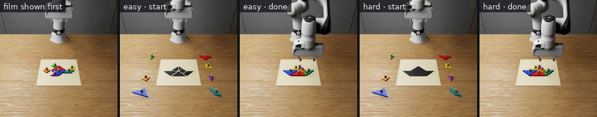

- **指令（种子 0）：** *“照我完成我那张卡片的方式，完成你的卡片。”*
- **提示：** *“拼块可以在手中转动，但不能翻面。”*
- **预先展示：** 1 段视频——“我的卡片，已完成。”
- **缺失信息：** 卡片的用途——只有画面显示拼块摆在剪影上、把剪影填满；指令只说了“照我完成我那张卡片的方式”
- **简单 → 困难：** 卡片：剪影上画出了每块拼块的轮廓 → 只有剪影
- **成功条件：** 七块拼块都在剪影上，每块平放，与一个同形状的位置相差不超过 1.5 厘米和 15 度；剪影的任一种拼法都算（鱼有两种：两块大三角形拼成的正方形可沿任一条对角线分）
- **运行限制：** 90 轮，仿真时间 12 分钟（两种难度相同）
- **Isaac 上的脚本参考策略（种子 0–24）：** 简单 25/25，用时 85 秒 · 困难 25/25，用时 85 秒

**CL6 Knight's Move（骑士走法）** · 单臂（FR3）

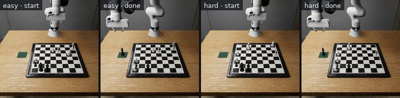

- **指令（种子 0）：** *“用白方骑士吃掉黑方国王。骑士按国际象棋的规则走，但和中国象棋的马一样：在它走两格的方向上，若紧挨着有棋子，就不能越过。你每走一步，黑方随后走一步。”*
- **提示：** *“只有骑士会移动，且它不能落在己方棋子所在的格子上。吃子时，先把国王从棋盘上拿走，再把骑士放到它的格子上。黑方国王会自己移动。”*
- **缺失信息：** 所述规则下的路线——蹩马腿规则只写在指令里，而国际象棋棋手会走的每一条近路都会经过被蹩住的马腿——以及时机：黑方国王在每一步之后都会移动，骑士必须在国王走进唯一一个可被吃掉的格子时恰好到达那里
- **简单 → 困难：** 对按所述规则行走的骑士而言，国王的距离：四步 → 六步——两种难度下，国际象棋骑士的最短路线都更短，并且都会经过被蹩住的马腿
- **成功条件：** 国王已离开棋盘，骑士站在它的格子上；每一步都是骑士走法，不越过马腿上的棋子，落到空格上，并放在离格子中心 2.2 厘米以内；没有移动或碰倒其他棋子，且骑士从未停在会被国王吃掉的位置
- **运行限制：** 60 轮，仿真时间 8 分钟（两种难度相同）
- **Isaac 上的脚本参考策略（种子 0–24）：** 简单 25/25，用时 44 秒 · 困难 25/25，用时 59 秒

### 主动探索（Discovery，DS）

*做什么，取决于场景里隐藏的事实，要先动手才能查出来。*

**DS1 Whose Present?（谁的礼物）** · 单臂（FR3）

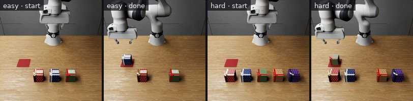

- **指令（种子 0）：** *“把 Tom 的礼物放到红色垫子上。”*
- **缺失信息：** 哪份礼物是谁的：名字太小，从固定相机看不清（简单），或朝向桌面（困难）
- **简单 → 困难：** 礼物数量及名字位置：三份，标签在顶部 → 五份，其中一份是 Tim 的，标签在底部（每份礼物都要拿起来翻过去才能读到）
- **成功条件：** Tom 的礼物静止在红色垫子上，且垫子上没有其他礼物
- **运行限制：** 简单 60 轮、8 分钟 · 困难 120 轮、16 分钟
- **Isaac 上的脚本参考策略（种子 0–24）：** 简单 25/25，用时 14 秒 · 困难 25/25，用时 51 秒

**DS2 Egg Hunt（寻找彩蛋）** · 单臂（FR3） · 开发任务

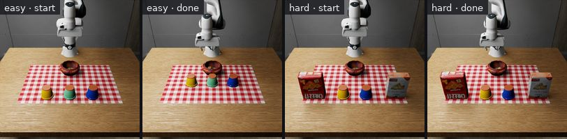

- **指令（种子 0）：** *“找到彩蛋，把它放进篮子里。”*
- **提示：** *“盆可以拿起来，盒子可以挪动。”*
- **缺失信息：** 彩蛋藏在哪里
- **简单 → 困难：** 彩蛋可能藏的位置：三个盆中某一个的下面 → 两个盆中某一个的下面，或两个立着的盒子中某一个的后面（需要把腕部相机绕过去看）
- **成功条件：** 彩蛋静止在篮子里，且没有碰倒任何盒子
- **运行限制：** 简单 120 轮、16 分钟 · 困难 140 轮、19 分钟
- **Isaac 上的脚本参考策略（种子 0–24）：** 简单 25/25，用时 33 秒 · 困难 25/25，用时 28 秒

**DS3 Treasure Hunt（寻宝）** · 单臂（FR3）

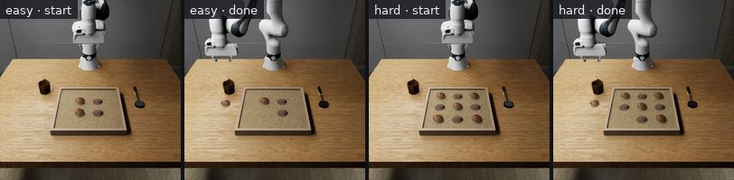

- **指令（种子 0）：** *“找到金币，把它放进桶里。只能掀开一个贝壳。”*
- **提示：** *“把探测器的线圈贴近沙面时，它会有反应——线圈离金属越近，线圈越亮（暗、琥珀色、红色），手柄上的五盏灯亮起的也越多。”*
- **缺失信息：** 哪个贝壳下藏着金币——看不出任何迹象，只有探测器能告诉你，且只能掀开一个贝壳
- **简单 → 困难：** 贝壳数量：四个 → 九个，逐一扫过要花很长时间，而相邻贝壳上方的灯光能指示该往哪个方向找
- **成功条件：** 金币静止在桶里，且从未掀开第二个贝壳
- **运行限制：** 简单 72 轮、10 分钟 · 困难 112 轮、15 分钟
- **Isaac 上的脚本参考策略（种子 0–24）：** 简单 25/25，用时 44 秒 · 困难 25/25，用时 51 秒

**DS4 Fake Coin（假硬币）** · 单臂（FR3）

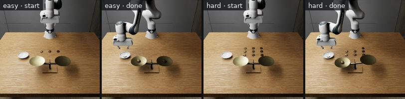

- **指令（种子 0）：** *“其中一枚硬币是假的——它更轻。把假硬币放进碟子里。”*
- **提示：** *“把硬币放在天平的两个秤盘上比较：较重的一侧会下沉。”*
- **缺失信息：** 哪枚硬币是假的：它和其他硬币看起来一样，只有天平能区分
- **简单 → 困难：** 待区分的硬币：三枚（称一次）→ 九枚（最少称两次）
- **成功条件：** 只有假硬币静止在碟子里，且真硬币从未进过碟子；称重次数超过最少次数的两倍（三枚时超过两次，九枚时超过四次）即为违规
- **运行限制：** 简单 76 轮、10 分钟 · 困难 148 轮、20 分钟
- **Isaac 上的脚本参考策略（种子 0–24）：** 简单 25/25，用时 32 秒 · 困难 25/25，用时 162 秒

**DS5 Find the Acid（找出酸）** · 单臂（FR3）

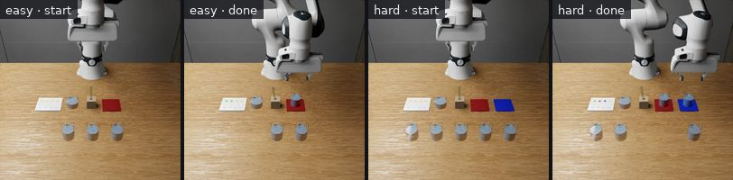

- **指令（种子 0）：** 简单 *“有一个烧杯装的是酸。把它放到红色垫子上。”* · 困难 *“把酸放到红色垫子上，把碱放到蓝色垫子上。”*
- **提示：** *“pH 试纸遇酸变红，遇碱变蓝。”*
- **缺失信息：** 哪个烧杯装的是什么——它们看起来一样，只有测试能区分——以及如何测试：试纸从不放进烧杯里，且每测完一杯都要冲洗玻璃棒
- **简单 → 困难：** 烧杯和试纸：三个烧杯、四张试纸，找出酸 → 五个烧杯，找出酸和碱，只有四张试纸
- **成功条件：** 酸在红色垫子上（困难难度下，碱在蓝色垫子上），垫子上只有它，且没有碰倒任何东西
- **运行限制：** 简单 76 轮、10 分钟 · 困难 100 轮、13 分钟
- **Isaac 上的脚本参考策略（种子 0–24）：** 简单 25/25，用时 46 秒 · 困难 25/25，用时 88 秒

**DS6 Flame Test（焰色反应）** · 单臂（FR3）

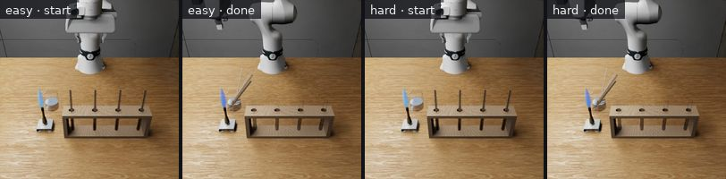

- **指令（种子 0）：** 简单 *“让火焰变成绿色。”* · 困难 *“让火焰先变成红色，再变成绿色。”*
- **提示：** *“每根木条都在它所在试管的溶液里浸过。把木条浸过的一端伸进火焰，就能看到它产生的颜色；用过的木条放进盛水的烧杯。”*
- **缺失信息：** 哪根木条烧出哪种颜色——实验台上没有任何标示，只有伸进火焰试过才知道
- **简单 → 困难：** 所要求的火焰颜色：绿色 → 先红后绿（两根木条，一根接一根；如果某根木条在红色出现之前先烧出了绿色，就要把它留到轮到它的时候）
- **成功条件：** 火焰依次呈现所要求的每种颜色，各持续 1 秒
- **运行限制：** 简单 88 轮、12 分钟 · 困难 100 轮、13 分钟
- **Isaac 上的脚本参考策略（种子 0–24）：** 简单 25/25，用时 32 秒 · 困难 25/25，用时 51 秒

### 动态交互（Dynamic interaction，DI）

*做什么是明摆着的；何时做，要随着场景的变化当场决定，而且时间很紧。*

**DI1 Rocket Launch（发射火箭）** · 双臂（ARX X5）

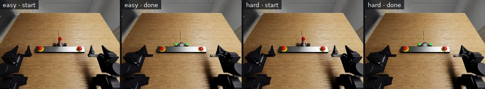

- **指令（种子 0）：** *“发射火箭。”*
- **缺失信息：** 发射的方式：两个按钮要同时按下（两盏灯都亮），以及按钮是否会弹回
- **简单 → 困难：** 按钮按下后是否保持：会锁住（先后按下即可）→ 会弹回（两个按钮须同时按住 0.5 秒）
- **成功条件：** 火箭已升空
- **运行限制：** 30 轮，仿真时间 4 分钟（两种难度相同）
- **Isaac 上的脚本参考策略（种子 0–24）：** 简单 25/25，用时 11 秒 · 困难 25/25，用时 11 秒

**DI2 Load the Train（给火车装货）** · 单臂（FR3）

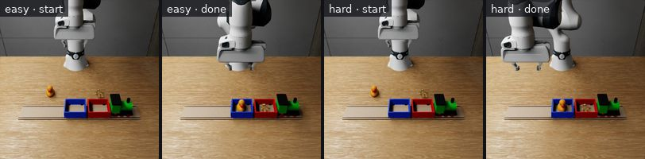

- **指令（种子 0）：** *“把泰迪熊放进红色车厢，把小鸭放进蓝色车厢。”*
- **提示：** *“火车沿轨道不停地来回行驶。在车厢上方松开的玩具会落进车厢。”*
- **缺失信息：** 松开小熊时车厢会在哪里
- **简单 → 困难：** 火车在一个 T_ref 内的行驶距离除以车厢的余量（T_ref = 8 秒时分别为 1.1 厘米和 18 厘米）
- **成功条件：** 泰迪熊在红色车厢里、小鸭在蓝色车厢里，两者相对各自车厢均静止 2 秒
- **运行限制：** 80 轮，仿真时间 11 分钟（两种难度相同）
- **Isaac 上的脚本参考策略（种子 0–24）：** 简单 25/25，用时 17 秒 · 困难 25/25，用时 18 秒

**DI3 Traffic Light（红绿灯）** · 单臂（FR3）

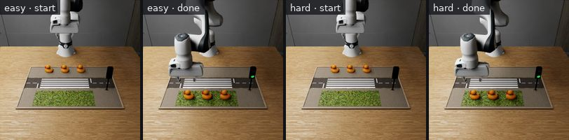

- **指令（种子 0）：** *“把小鸭一只一只地带过马路，送到草地上。只在绿灯时过马路：红灯时马路上不能有小鸭。”*
- **缺失信息：** 信号灯何时变化——变化发生之前，这个时间点并不存在
- **简单 → 困难：** 信号灯如何变化（以 T_ref 计，取 8 秒）：绿灯 2–2.5 T_ref（16–20 秒），红灯 2 T_ref，从红灯开始，变红后有 1 秒时间离开马路 → 绿灯 0.31–0.44 T_ref（2.5–3.5 秒；从不短于 2.5 秒，即机械臂把一只小鸭运过马路所需的时间），红灯 3 秒，离开马路的时间为 0.5 秒
- **成功条件：** 所有小鸭都在草地上并静止，一次只过一只，且红灯持续超过允许离开马路的时间后，马路上没有小鸭
- **运行限制：** 简单 1,296 轮、30 分钟 · 困难 400 轮、30 分钟
- **Isaac 上的脚本参考策略（种子 0–24）：** 简单 25/25，用时 89 秒 · 困难 25/25，用时 38 秒

**DI4 Simon Says（Simon 说）** · 单臂（FR3） · 开发任务

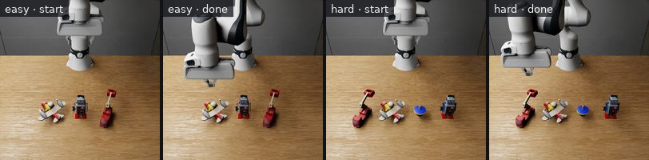

- **指令（种子 0）：** *“我们来玩 Simon 说：照 Simon 说的做——而且只做这些。”*
- **提示：** *“要触碰一个玩具，用闭合的夹爪从上方轻敲它。“Simon 说”的口令要立刻执行——它只在下一条口令说出之前有效，漏掉一条就输了。”*
- **缺失信息：** 口令本身：每条口令说了什么，以及是否以“Simon 说”开头——两者在说出之前都不存在
- **简单 → 困难：** 口令如何出现：四条，其中一条不带“Simon 说”，间隔 2.5 T_ref（8 秒时为 20 秒）→ 六条，其中两条不带，间隔 1 T_ref（8 秒），每条不带“Simon 说”的口令都紧跟在一条针对同一玩具的口令之后；两种难度下，第一条口令都在 2 T_ref 之后出现，留出先观察玩具的时间
- **成功条件：** 每条带“Simon 说”的口令都在其有效期间内完成、不顺带碰别的玩具，且没有执行任何不带它的口令
- **运行限制：** 简单 212 轮、28 分钟 · 困难 148 轮、20 分钟
- **Isaac 上的脚本参考策略（种子 0–24）：** 简单 25/25，用时 96 秒 · 困难 25/25，用时 64 秒

**DI5 Whack-a-Mole（打地鼠）** · 双臂（ARX X5）

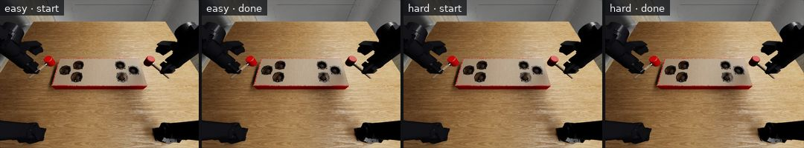

- **指令（种子 0）：** *“用锤子敲地鼠！”*
- **提示：** *“每条臂只能够到自己一侧的三个洞。每把锤子平放在手中，锤头中心沿锤柄距握持处 8.6 厘米，锤头直径 4.7 厘米。地鼠冒出时，锤头落到它的顶部即算击中。”*
- **缺失信息：** 下一只地鼠从哪里冒出：在它冒出之前，这个信息并不存在
- **简单 → 困难：** 地鼠如何冒出：一次一只，每只停留 2.5 T_ref（8 秒时为 20 秒）→ 两侧同时各冒出一只，停留 0.375 T_ref（3 秒）。两种难度下第一只地鼠都在 3 T_ref 时冒出（24 秒）
- **成功条件：** 除一只外，所有地鼠都在缩回之前被击中，且必须由手持锤子的锤头落下击中；对空洞挥锤不超过三次
- **运行限制：** 简单 580 轮、30 分钟 · 困难 138 轮、18 分钟
- **Isaac 上的脚本参考策略（种子 0–24）：** 简单 25/25，用时 93 秒 · 困难 25/25，用时 22 秒（v2.3.3，地鼠从 2 秒开始冒出）

**DI6 Dessert Covers（甜点罩）** · 单臂（FR3）

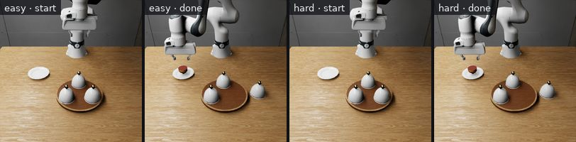

- **指令（种子 0）：** *“蛋糕在离你最近的罩子下面。注意看转盘，等它停下后，找到蛋糕并把它放到盘子上。”*
- **提示：** *“只能掀开一个罩子。”*
- **缺失信息：** 罩着蛋糕的罩子最终停在哪里——转盘停下之前，这个信息并不存在，只有一直跟踪那个罩子才能知道
- **简单 → 困难：** 转盘如何转动：一次，在 1.75 T_ref（8 秒时为 14 秒，0.15 rad/s）内转三分之一圈 → 三次，每次在 0.22 T_ref（1.75 秒，1.2 rad/s）内转三分之一圈，来回转动。两种难度下转盘都在 3 T_ref 时开始转（24 秒）
- **成功条件：** 蛋糕在盘子上，只掀开了一个罩子，且没有在转盘停下前掀开任何罩子
- **运行限制：** 简单 172 轮、23 分钟 · 困难 87 轮、12 分钟
- **Isaac 上的脚本参考策略（种子 0–24）：** 简单 25/25，用时 57 秒 · 困难 25/25，用时 42 秒（v2.3.3，转盘从 3 秒开始转）

### 接触操作（Contact-rich manipulation，CR）

*做什么是明摆着的；怎么做要自己想清楚，难在接触：插、拧、推、按、叠。*

**CR1 Shape Sorter（形状配对盒）** · 单臂（FR3） · 开发任务

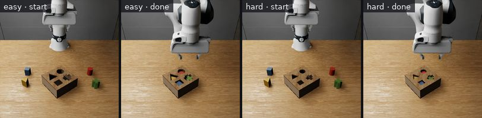

- **指令（种子 0）：** *“把每块积木从和它形状一样的孔放进盒子。”*
- **提示：** *“盖子固定在盒子上。积木穿过孔之后就拿不出来了。”*
- **缺失信息：** 每块积木要转成什么角度才进得去；架在盖板上的那块该怎么办
- **简单 → 困难：** 积木和孔沿之间一圈的余量：6 毫米 → 2 毫米
- **成功条件：** 四块积木都在盒里并静止 1 秒，且每块都是从自己形状的孔掉进去的
- **运行限制：** 120 轮，仿真时间 16 分钟（两种难度相同）
- **Isaac 上的脚本参考策略（种子 0–24）：** 简单 25/25，用时 43 秒 · 困难 25/25，用时 43 秒

**CR2 Screw the Bulb（拧灯泡）** · 单臂（FR3）

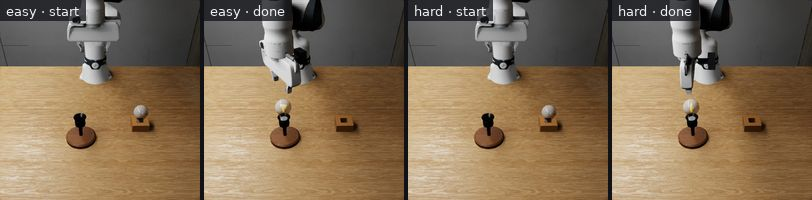

- **指令（种子 0）：** *“把灯泡拧进台灯。”*
- **提示：** *“灯泡拧到底，灯就亮。”*
- **缺失信息：** 灯泡怎么装：往哪边拧；手腕一次拧不完——拧一段、松手、把手转回来、再握住
- **简单 → 困难：** 灯泡要在灯口里拧多少灯才亮：四分之一圈 → 两圈
- **成功条件：** 灯亮（灯泡在灯口里顺时针拧够了这一档要求的圈数），手松开，灯泡立在灯口里（灯头在灯座孔中），保持 2 秒
- **运行限制：** 简单 60 轮，仿真时间 8 分钟 · 困难 120 轮，仿真时间 16 分钟
- **Isaac 上的脚本参考策略（种子 0–24）：** 简单 25/25，用时 17 秒 · 困难 25/25，用时 44 秒

**CR3 Curling（推冰壶）** · 单臂（FR3）

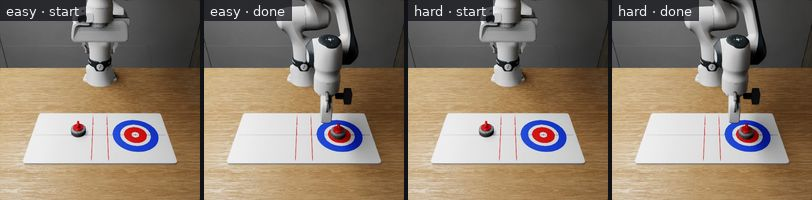

- **指令（种子 0）：** 简单 *“把冰壶推进大本营。”* · 困难 *“把冰壶推到大本营正中的白圆上，盖住它。”*
- **提示：** *“冰壶只能贴着垫子推：不许夹，也不许抬。手停在哪，壶就停在哪。”*
- **缺失信息：** 不许夹的冰壶怎么挪：从哪边推、推多远；推的线不过壶心，壶会往旁边溜
- **简单 → 困难：** 壶心停在离大本营中心多远以内：9 厘米（进大本营）→ 1.5 厘米（盖住中心白圆）
- **成功条件：** 冰壶静止 2 秒，壶心在目标区内，还在垫子上，从没被手指夹住过（手指部分合拢夹住也算）、也没被抬起过
- **运行限制：** 60 轮，仿真时间 8 分钟（两种难度相同）
- **Isaac 上的脚本参考策略（种子 0–24）：** 简单 25/25，用时 7 秒 · 困难 25/25，用时 7 秒

**CR4 Graphics Card（插显卡）** · 单臂（FR3）

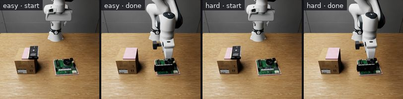

- **指令（种子 0）：** *“把显卡插进主板上的白色长插槽，压到底。”*
- **提示：** *“金手指完全压进插槽才算插好；插好后插槽会把卡咬住。”*
- **缺失信息：** 平躺的显卡要怎么拿才插得进去——手放平，从侧面夹住悬出垫子的那条边；之后要让金手指朝下、转到插槽的方向，再压到它自己立住
- **简单 → 困难：** 金手指在槽口里每侧的余量：3 毫米 → 1 毫米（槽口往下收窄，把金手指夹住）
- **成功条件：** 金手指到插槽底部，显卡立在插槽里，手离开，保持 2 秒
- **运行限制：** 90 轮，仿真时间 12 分钟（两种难度相同）
- **Isaac 上的脚本参考策略（种子 0–24）：** 简单 25/25，用时 18 秒 · 困难 25/25，用时 19 秒

**CR5 Snap the Bricks（拼积木）** · 单臂（FR3）

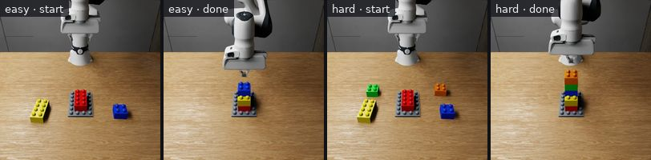

- **指令（种子 0）：** 简单 *“把黄色积木按到红色积木上，正好盖住它；再把蓝色积木按到黄色积木的正中。”* · 困难 *“把黄色积木按到红色积木上，正好盖住它；把蓝色积木按到黄色积木的正中，绿色积木按到蓝色积木上，橙色积木按到绿色积木上。”*
- **提示：** *“积木要顺着凸点按到底才算扣上；下面那块没按到底，上面的就扣不住。”*
- **缺失信息：** 积木怎么装上去：对正凸点（差几毫米以内）、套下去、再按到底，直到它下面的缝合上；架在凸点上的那块该怎么办
- **简单 → 困难：** 要拼的积木数：2 块 → 4 块
- **成功条件：** 每块积木都在下面那块的正中、与它对齐并压到底；手里没有积木，手离开塔，保持 2 秒
- **运行限制：** 简单 70 轮，仿真时间 9 分钟 · 困难 100 轮，仿真时间 13 分钟
- **Isaac 上的脚本参考策略（种子 0–24）：** 简单 25/25，用时 34 秒 · 困难 25/25，用时 65 秒

**CR6 Fold the T-Shirt（叠 T 恤）** · 双臂（ARX X5）

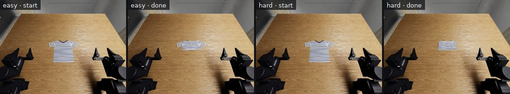

- **指令（种子 0）：** 简单 *“把 T 恤对折：下摆折到肩上。”* · 困难 *“把 T 恤叠好：先把两只袖子折到身上，再把下摆折到肩上。”*
- **提示：** *“手指在布上合拢就捏住了布：指尖下的布跟着手走，手张开才放下。”*
- **缺失信息：** 衣服怎么叠：捏住布边，一边一只手，两只手一起提起来绕着折线翻过去——不是贴着桌面推，也不是一个角一个角地翻——在布边该落下的地方松手；困难难度还有先折哪一下
- **简单 → 困难：** 要折几下：1 下（下摆折到肩上）→ 3 下（先把两只袖子折到身上）
- **成功条件：** T 恤按要求叠好——衣服上的标记点离叠好的形状平均不超过 8 毫米（折几下就乘以折数的平方根），最偏的不超过 4 厘米，叠在桌上哪里都行，但不能是镜像——手离开，保持 2 秒
- **运行限制：** 简单 60 轮，仿真时间 8 分钟 · 困难 100 轮，仿真时间 13 分钟
- **Isaac 上的脚本参考策略（种子 0–24）：** 简单 25/25，用时 14 秒 · 困难 25/25，用时 36 秒

