# RUIBench: the tasks in full

The [README](../README.md) has the overview and the table of the tasks.
This page has the rest: what every episode shares, how the missions and
their splits are drawn, and each task with its pictures.

## The 30 tasks at a glance

One declared knob separates a task's easy and hard levels; its card lists what else changes with it.

| Task | Arms | What is asked | Easy -> hard |
|---|---|---|---|
| WK1 Tower of Hanoi | 1 | move the tower to the right peg, by the rules | 3 moves -> 7-11 moves, from a game in progress |
| WK2 River Crossing | 1 | ferry a wolf, a goat and a bucket (or a cabbage) across on a raft | one forbidden pair -> two |
| WK3 Domino Run | 1 | set up five dominoes so that a pendulum rings a bell through them | straight -> round a corner |
| WK4 Set the Table | 2 | set a place for the guest across the table | one place -> two |
| WK5 Balance Beam | 1 | level a beam with the weights on the tray | one weight -> two |
| WK6 Tic-Tac-Toe | 1 | win a game in progress as X | a win on the board -> wait for the one mistake |
| CL1 Play It Back | 2 | play the tune from the film on a toy xylophone | same xylophone -> bars rearranged, chords |
| CL2 Dolls' Names | 1 | "Put Momo to bed", Momo named in a film | one name -> two |
| CL3 Build the House | 1 | build the house drawn on a card | 3 blocks -> 7 |
| CL4 Crow and Pitcher | 1 | get the ball floating out of reach in a jar | 4 pebbles -> 8 |
| CL5 Tangram | 1 | finish the card the way the picture finished another | pieces outlined -> silhouette only |
| CL6 Knight's Move | 1 | capture a king with a knight under a rule told in the prompt | 4 moves -> 6 |
| DS1 Whose Present? | 1 | put Tom's present on the red mat | 3 presents, names on top -> 5, names underneath |
| DS2 Egg Hunt | 1 | find the painted egg and put it in the basket | under 3 pots -> 2 pots and 2 boxes |
| DS3 Treasure Hunt | 1 | find the coin with a toy metal detector, lifting one shell | 4 shells -> 9 |
| DS4 Fake Coin | 1 | find the lighter coin with a toy balance | 3 coins -> 9 |
| DS5 Find the Acid | 1 | find the acid (and the base) with pH strips | 3 beakers -> 5, 4 strips |
| DS6 Flame Test | 1 | make the flame green: which of four soaked splints burns green shows only in the flame | green -> red, then green |
| DI2 Load the Train | 1 | put a teddy and a duck in the wagons of a moving train | slow -> fast |
| DI3 Traffic Light | 1 | take three ducklings across a road on green | long greens -> short |
| DI4 Simon Says | 1 | do the calls Simon says, and no others | 4 calls -> 6, closer together |
| DI5 Whack-a-Mole | 2 | whack the moles with the mallets in hand | one at a time -> both sides at once |
| DI6 Dessert Covers | 1 | watch the turntable, then find the cake under its cover | one slow turn -> three quick ones |
| DI1 Rocket Launch | 2 | launch the rocket from a two-button console | latching buttons -> spring-back |
| CR1 Shape Sorter | 1 | put each block into the box through the hole of its own shape | 6 mm of room in the hole -> 2 mm |
| CR2 Screw the Bulb | 1 | screw the light bulb into the lamp until it lights | a quarter turn -> two turns |
| CR3 Curling | 1 | push the stone into the house, never gripping it | in the house (9 cm) -> covering the button (1.5 cm) |
| CR4 Graphics Card | 1 | fit the graphics card into the motherboard's slot and press it home | 3 mm of play in the slot's mouth -> 1 mm |
| CR5 Snap the Bricks | 1 | press toy bricks onto one another into a tower | 2 bricks to add -> 4 |
| CR6 Fold the T-Shirt | 2 | fold a T-shirt lying flat: its bottom edge up to its shoulders | 1 fold -> 3 (each sleeve in first) |

## What every episode shares

- **Robots and cameras.** Single-arm tasks: a Franka Research 3 at a table,
  a fixed camera across the table (512 x 512) and a wrist camera -- a
  RealSense D405 on a bracket behind the hand, which shows the fingers open
  or closed and what they hold. Two-arm tasks (WK4, CL1, DI1, DI5, CR6): two ARX
  X5 arms laid out as RoboDojo's station, its head camera between them
  (640 x 480, 60 degrees down) and a wrist camera on each arm.
- **Simulator.** Results come from Isaac Sim 4.5 with Isaac Lab 2.1,
  rendered with RTX: the models under test were never fine-tuned on these
  images, so whatever is rendered *is* the observation. A mock engine -- no
  physics, no pixels -- runs the same tasks for tests and for developing
  task logic; it never produces a result.
- **What the agent is told.** The instruction; for some tasks a hint (what a
  person teleoperating the robot would also be told: a rule of the game, how
  a toy works); for four of the In-context learning tasks (CL1, CL2, CL4,
  CL5), one or two films played before the episode starts. Everything else it gets from its cameras and
  the arm's readings, through its interface's tools -- with a real robot's
  perception error, and never the simulator's state, the objects' internal
  names, the seed or the scorer.
- **How it acts.** Through one interface, one of RUIKit's 13 RUIs: an action
  abstraction (Joint, Delta, Step, Pose, Point or Skill) in an interaction
  form (per-action or program), or RUI-Free, which offers them all (see
  [Robot Agents and RUIKit](../README.md#-ruikit-13-robot-use-interfaces) in the
  README). All of them drive the same controller.
- **Time.** The world keeps moving while the model thinks: in the main
  setting for 8 s of simulated time a reply, the same for every model
  (`--clock 8s`); on the measured clock for as long as the model really took
  to reply (time spent waiting on the API is not counted). The timed tasks
  (DI1-DI6) state their speeds in `T_ref`, 8 s -- set from three models'
  measured reply times.
- **Limits.** Each task-level has a turn budget (30 to 1,296 model turns, ten
  replies a turn; listed per task below) and a simulated-time limit of that
  many turns times `T_ref`, never more than 30 minutes. Reaching the goal
  does not end an episode: the agent's `task_done` or `task_give_up` does, or
  either limit, and it is judged on the world as it is then (an episode that
  ended the moment it succeeded would tell the agent so).
- **Success.** Decided by the benchmark from what physically happened, never
  from what the agent reports, and decided again offline from the log
  (`ruibench rescore`). Milestones measure partial progress. A physics audit
  flags anything physics would not do (a teleport, a throw, a joint past its
  stop); a flagged episode fails until someone has looked at it.

## Missions and splits

- **Missions.** A seed lays a mission out: where everything stands and which
  way it is turned, which present is Tom's (DS1), under which pot the egg is
  hidden (DS2), from which position a hard Tower of Hanoi starts (WK1). The
  same seed gives the same mission on every machine. Only CL2's instruction
  changes with the seed (the dolls' names).
- **Splits.** `ruibench/tasks/splits.json` deals each task-level's missions
  out: **15 for development, 20 for testing, 5 spare**. Seeds are taken in
  order from 0, and a seed is kept only if its layout passes the geometric
  checks of `ruibench validate` (in reach, in the fixed camera's view, not
  hidden under other things or the arms, graspable, nothing in the hand's
  way) and the scripted reference solved it on Isaac (every full sweep runs
  seeds 0-24 of every task-level).
- **Today.** Every task-level uses seeds 0-14 for development, 15-34 for
  testing and 35-39 as spares -- except CL2 hard, whose reference failed
  seeds 1, 7, 9, 10, 12, 14 and 22 (the dolls bounce off the sofa), so its
  40 missions come from seeds 0-46. The paper's tables use the easy level
  and the first test seed (15) of every task.
- **Size.** One model through one interface, on the 30 tasks
  (60 task-levels): 900 development episodes (60 x 15) and 1,200 test
  episodes (60 x 20); through all 13 RUIs, 11,700 and 15,600. The paper's
  main table is 30 tasks x 13 RUIs x one test seed: 390 episodes per agent. A
  model episode takes roughly 5-20 minutes on Isaac.
- **Task roles.** One task per suite is the *development task* (WK1, CL3, DS2,
  DI4, CR1), on which prompts, levels and the scorer are tuned; it stays on
  the board. Each suite also keeps a *held-out template*, designed but
  deliberately never implemented (WK7, CL7, DS7, DI7, CR7).
- `ruibench seeds DS1 easy` prints a task-level's development seeds. The
  splits were frozen early and are unchanged since for the tasks they
  held (a new task's seeds were added when it was built); the benchmark is
  frozen as **v1.0.0**, the paper's version. `ruibench freeze` fingerprints every file that shapes an
  episode -- the task cards and their code, scoring, the Isaac engine (not
  the mock, which never produces a result), RUIKit's interfaces and tools --
  and `T_ref`. Changing any of them voids that version's test results;
  `ruibench validate` and `ruibench freeze --check` list what has changed,
  and the splits can no longer be regenerated. A change worth keeping
  becomes a new version (`ruibench freeze <version> --again`); results compare
  only within a version.

## Task by task

Each strip is the fixed camera in the showcase recording (seed 0): the
scripted reference at the start and at the end of an easy and of a hard
mission -- for In-context learning, after a frame of the film shown first.
The videos, with the wrist cameras and the instruction, are on the showcase
page: `ruibench showcase` records it, `ruibench serve` serves it
(http://localhost:8765/showcase/index.html on this machine). "Told" is
seed 0's instruction.

### World knowledge (WK)

*What to do comes from the model's own knowledge and reasoning; nothing on the table gives the answer.*

**WK1 Tower of Hanoi** · 1 arm (FR3) · development task

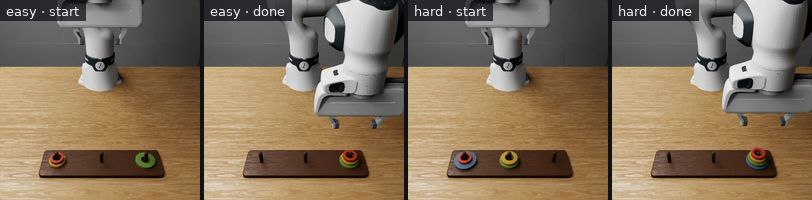

- **Told (seed 0):** *"Solve the Tower of Hanoi: move the tower to the peg on the right, as the front camera shows it."*
- **Hint:** *"Only the top ring of a peg can be taken, and a ring may never go onto a smaller one."*
- **Missing:** the moves: everyone knows the rules, the solution has to be worked out
- **Easy → hard:** the game: three rings, the largest already on the goal peg (3 moves) → four rings from a game in progress, drawn per seed from every position 7 to 11 moves from the end
- **Success:** every ring on the right peg, largest at the bottom, standing still for 2 s, and every move legal (one ring at a time, a top ring only, rings put down only on pegs, never on a smaller ring) -- judged from where the rings are as well as from what a hand holds
- **Limits:** 120 turns, 16 min of simulated time (both levels)
- **Scripted reference on Isaac (seeds 0-24):** easy 25/25 in 26 s · hard 25/25 in 82 s

**WK2 River Crossing** · 1 arm (FR3)

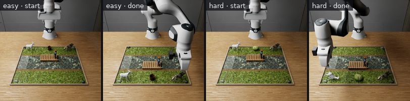

- **Told (seed 0):** easy *"Ferry the wolf, the goat and the bucket across. The raft carries the farmer and one more. Never leave the wolf alone with the goat."* · hard *"Ferry the wolf, the goat and the cabbage across. The raft carries the farmer and one more. Never leave the goat alone with the wolf or the cabbage."*
- **Hint:** *"Lift a passenger onto the raft to take it along -- once it is aboard and the hand is away, the raft crosses to the other bank with the farmer and it. To send the raft across with nobody aboard, tap its deck."*
- **Missing:** the order of the crossings (the classic puzzle: the goat comes back once)
- **Easy → hard:** rules to keep: the wolf and the goat; or the classic two (goat with wolf, goat with cabbage), which needs the goat brought back once
- **Success:** all three on the far bank and still; until then no bank the raft was not at held a forbidden pair, nothing was put down in the water, and nothing changed bank except aboard the raft, put on and taken off where it lay docked
- **Limits:** 120 turns, 16 min of simulated time (both levels)
- **Scripted reference on Isaac (seeds 0-24):** easy 25/25 in 93 s · hard 25/25 in 145 s

**WK3 Domino Run** · 1 arm (FR3)

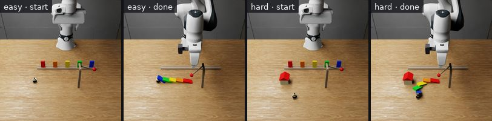

- **Told (seed 0):** *"Set up the dominoes so the pendulum rings the bell. It is let go when you say you are done."*
- **Missing:** how dominoes must stand to fall in a chain, and when the run is ready
- **Easy → hard:** the route: the bell straight ahead of the swing → the bell round a corner, behind a toy house, so the chain has to turn
- **Success:** the pendulum let go with no domino in the hand and none lying on the bell, then the bell rung by a domino that was standing at the let-go
- **Limits:** 60 turns, 8 min of simulated time (both levels)
- **Scripted reference on Isaac (seeds 0-24):** easy 25/25 in 53 s · hard 25/25 in 52 s

**WK4 Set the Table** · 2 arms (ARX X5)

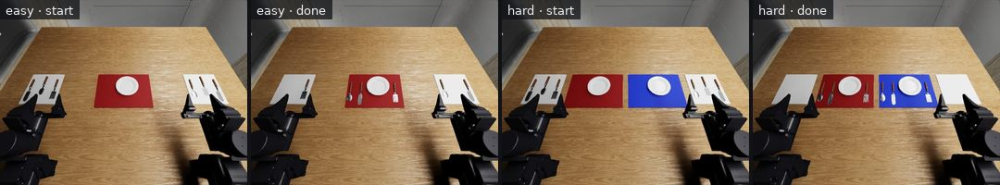

- **Told (seed 0):** easy *"Set the table for the guest across from you."* · hard *"Set the table for the two guests across from you."*
- **Hint:** *"Each arm reaches only its own side of the table."*
- **Missing:** where a fork, a knife and a spoon go at a place setting
- **Easy → hard:** places to set, three pieces each: one guest straight across -- the fork on the right arm's side, the rest on the left's → two guests side by side, a place for each arm
- **Success:** each place set, judged by side and order: lying straight on the place's mat and level with its plate, from the guest's side a fork beside the plate on its left, a knife on its right and a spoon beyond the knife (mirrored from the robot's side), and no fork on the knife's side nor knife or spoon on the fork's; everything still for 1.5 s
- **Limits:** 90 turns, 12 min of simulated time (both levels)
- **Scripted reference on Isaac (seeds 0-24):** easy 25/25 in 22 s · hard 25/25 in 34 s

**WK5 Balance Beam** · 1 arm (FR3)

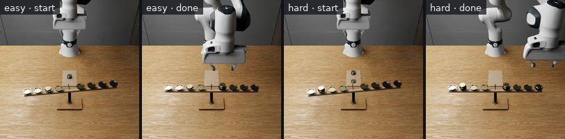

- **Told (seed 0):** *"Make the balance level, using everything on the tray. Leave what is on it already."*
- **Hint:** *"The brass weights all weigh the same, one each; a stack of two weighs twice as much. The pans stand 1, 2, 3 and 4 steps from the pivot on each side. Each weight from the tray may be set down once -- one let go in a pan is not to be picked up again."*
- **Missing:** how a lever works -- that a weight twice as far from the pivot pulls twice as hard; nothing on the beam says so
- **Easy → hard:** the problem on the beam: a single weight at step two to balance with a double one (at step one) → a double at step three to balance with a double and a single, one to a pan (the double at step one, the single at step four)
- **Success:** the beam level for 2 s, every weight from the tray in a pan on the right, the one already on the left left where it was, and no weight let go in a pan picked up again or moved to another pan
- **Limits:** 60 turns, 8 min of simulated time (both levels)
- **Scripted reference on Isaac (seeds 0-24):** easy 25/25 in 13 s · hard 25/25 in 27 s

**WK6 Tic-Tac-Toe** · 1 arm (FR3)

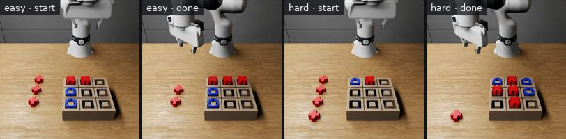

- **Told (seed 0):** *"You are X. Win the game."*
- **Hint:** *"Make a move by putting an X token into an empty square. The opponent's O tokens rise out of the board by themselves once your hand is off it -- keep it off while one comes up -- and the opponent says when the game is over."*
- **Missing:** the opponent's next move
- **Easy → hard:** where the win comes from: on the board (X has a winning move, O no threat) → a single mistake of the opponent (an X and an O, a draw with perfect play; O errs once, at its first or second reply, drawn per seed, and X wins only by forking)
- **Success:** X has three in a row, with one X move a turn, no X on a taken cell, no placed X moved, and the hand off the board while an O came up -- fouls counted until the game is over
- **Limits:** 40 turns, 5 min of simulated time (both levels)
- **Scripted reference on Isaac (seeds 0-24):** easy 25/25 in 11 s · hard 25/25 in 40 s

### In-context learning (CL)

*What to do comes from what this episode gives: a film, a picture, a rule told on the spot.*

**CL1 Play It Back** · 2 arms (ARX X5)

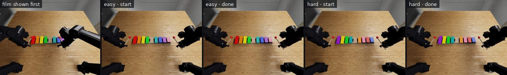

- **Told (seed 0):** *"Play the tune from the video."*
- **Hint:** *"A bar sounds when a mallet's head strikes it from above. The left arm plays the bars on the left, the right arm those on the right."*
- **Shown first:** 1 film -- "The robot plays a tune."
- **Missing:** the tune: only ever in the film, never in words
- **Easy → hard:** the xylophone and the tune: the film's xylophone, five notes, the hands taking turns → its bars' colours in another order (no bar keeps its colour) and two of the five steps chords, a bar of each hand struck together (within 0.4 s)
- **Success:** the film's steps played in order, by colour -- a chord's two bars within 0.4 s -- and no other bar played
- **Limits:** 40 turns, 5 min of simulated time (both levels)
- **Scripted reference on Isaac (seeds 0-24):** easy 25/25 in 15 s · hard 25/25 in 16 s

**CL2 Dolls' Names** · 1 arm (FR3)

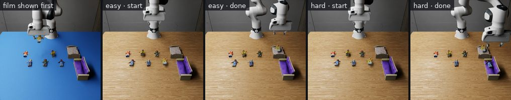

- **Told (seed 0):** easy *"Put Nono to bed."* · hard *"Put Nono to bed and Pipa on the sofa."*
- **Shown first:** 2 films -- "This is Nono."; "This is Pipa."
- **Missing:** which doll a name belongs to: a film introduces it once
- **Easy → hard:** new names to learn: Momo, or Momo and Kiki (each to its own place)
- **Success:** the named doll at rest in the bed (and, hard, the second at rest on the sofa), no other doll moved, and no doll ever set down where it does not belong
- **Limits:** easy 30 turns, 4 min · hard 45 turns, 6 min
- **Scripted reference on Isaac (seeds 0-24):** easy 25/25 in 9 s · hard 18/25 in 19 s; seeds left out of the splits: 1, 7, 9, 10, 12, 14, 22

**CL3 Build the House** · 1 arm (FR3) · development task

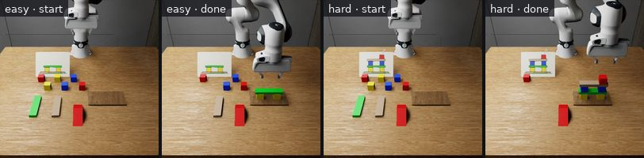

- **Told (seed 0):** *"Build the house on the card, on the wooden board."*
- **Missing:** what to build and in what order: only on the card
- **Easy → hard:** blocks in the house on the card: a gate (two cubes and a plank) → a doorway and its lintel, a second storey with a flat roof, and a chimney in the third colour
- **Success:** every block the card shows stands where the card puts it relative to the others, the house anywhere on the board, nothing else on the board, and the house still for 3 s
- **Limits:** 60 turns, 8 min of simulated time (both levels)
- **Scripted reference on Isaac (seeds 0-24):** easy 25/25 in 33 s · hard 25/25 in 78 s

**CL4 Crow and Pitcher** · 1 arm (FR3)

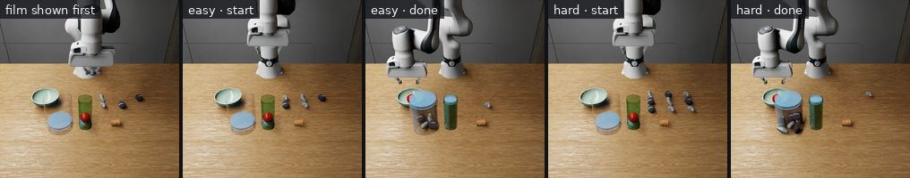

- **Told (seed 0):** *"Get the ball out of the jar and put it in the dish."*
- **Shown first:** 2 films -- "A stone dropped into the well."; "A cork dropped into the well."
- **Missing:** the method: the films show what a stone and a cork do in the well, not how to get the ball -- putting the two together is the agent's; reaching for the ball fails wherever the hand goes
- **Easy → hard:** four stones → eight, and the same way to go
- **Success:** the ball is in the dish
- **Limits:** easy 110 turns, 15 min · hard 166 turns, 22 min
- **Scripted reference on Isaac (seeds 0-24):** easy 25/25 in 52 s · hard 25/25 in 94 s

**CL5 Tangram** · 1 arm (FR3)

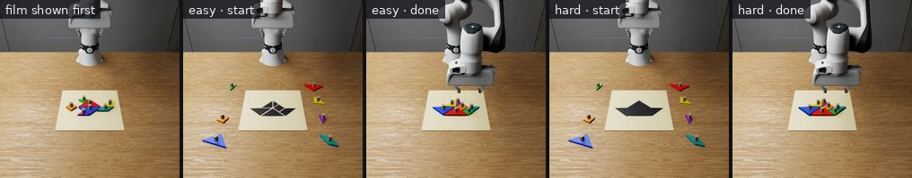

- **Told (seed 0):** *"Finish your card the way I finished mine."*
- **Hint:** *"The pieces can be turned in the hand, but not turned over."*
- **Shown first:** 1 film -- "My card, finished."
- **Missing:** what the card is for -- only the picture shows the pieces laid on a silhouette, filling it; the instruction says only "the way I finished mine"
- **Easy → hard:** the card: the silhouette with each piece's outline drawn in → the silhouette alone
- **Success:** all seven pieces on the silhouette, each lying flat within 1.5 cm and 15 degrees of a place of its own shape, in any tiling of the silhouette (the fish has two: its large triangles' square split across either diagonal)
- **Limits:** 90 turns, 12 min of simulated time (both levels)
- **Scripted reference on Isaac (seeds 0-24):** easy 25/25 in 85 s · hard 25/25 in 85 s

**CL6 Knight's Move** · 1 arm (FR3)

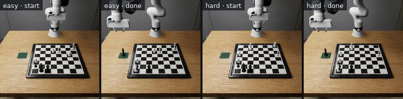

- **Told (seed 0):** *"Capture the black king with the white knight. The knight moves as in chess, but like the horse in Chinese chess it cannot move past a piece standing next to it in the direction of its two-square step. Black moves after each of your moves."*
- **Hint:** *"Only the knight moves, and it may not land on a square of its own side. To capture, take the king off the board and put the knight on its square. Black's king moves by itself."*
- **Missing:** the route under the rule told -- the leg rule is only in the instruction, and every short way a chess player would take passes a blocked leg -- and when: black's king steps after every move, and the knight must come to the one square it can be taken on as the king steps into it
- **Easy → hard:** how far the king is for the knight told about: four moves → six -- at both levels a chess knight's shortest way is shorter and passes a blocked leg
- **Success:** the king off the board and the knight standing on its square, every move a knight's move past no piece on its leg onto an empty square, set down within 2.2 cm of a square's middle; no other piece moved or knocked over, and the knight never left where the king takes it
- **Limits:** 60 turns, 8 min of simulated time (both levels)
- **Scripted reference on Isaac (seeds 0-24):** easy 25/25 in 44 s · hard 25/25 in 59 s

### Discovery (DS)

*What to do depends on a fact hidden in the scene, found only by acting.*

**DS1 Whose Present?** · 1 arm (FR3)

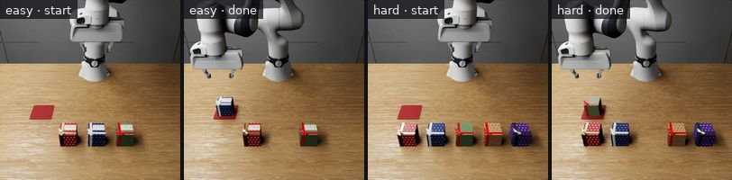

- **Told (seed 0):** *"Put Tom's present on the red mat."*
- **Missing:** whose present is whose: the names are too small to read from the fixed camera (easy) or face the table (hard)
- **Easy → hard:** how many presents, and where the names are: three, the tags on top → five, one of them Tim's, the labels underneath (each present picked up and turned over to be read)
- **Success:** Tom's present at rest on the red mat, and no other present on it
- **Limits:** easy 60 turns, 8 min · hard 120 turns, 16 min
- **Scripted reference on Isaac (seeds 0-24):** easy 25/25 in 14 s · hard 25/25 in 51 s

**DS2 Egg Hunt** · 1 arm (FR3) · development task

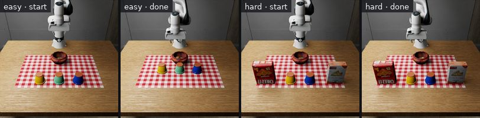

- **Told (seed 0):** *"Find the painted egg and put it in the basket."*
- **Hint:** *"The pots can be lifted and the boxes moved."*
- **Missing:** where the egg is hidden
- **Easy → hard:** where the egg may hide: under one of three pots → under one of two pots or behind one of two standing boxes (the wrist camera has to be taken round)
- **Success:** the egg at rest in the basket, and no box knocked over
- **Limits:** easy 120 turns, 16 min · hard 140 turns, 19 min
- **Scripted reference on Isaac (seeds 0-24):** easy 25/25 in 33 s · hard 25/25 in 28 s

**DS3 Treasure Hunt** · 1 arm (FR3)

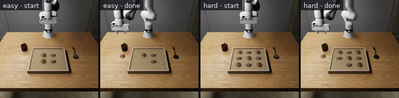

- **Told (seed 0):** *"Find the gold coin and put it in the bucket. Lift only one shell."*
- **Hint:** *"The detector answers when its coil is held low over the sand -- the nearer the coil is to metal, the more its coil glows (dark, amber, red) and the more of the five lights on its handle are lit."*
- **Missing:** which shell hides the coin -- nothing shows it, only the detector tells, and only one shell may be lifted
- **Easy → hard:** how many shells: four → nine, where sweeping every one takes long and the lights over the neighbours show which way to go
- **Success:** the coin at rest in the bucket, and never a second shell lifted
- **Limits:** easy 72 turns, 10 min · hard 112 turns, 15 min
- **Scripted reference on Isaac (seeds 0-24):** easy 25/25 in 44 s · hard 25/25 in 51 s

**DS4 Fake Coin** · 1 arm (FR3)

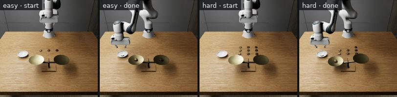

- **Told (seed 0):** *"One of the coins is fake -- it is lighter. Put the fake one in the dish."*
- **Hint:** *"Put coins on the two pans of the balance to compare them: the heavier side goes down."*
- **Missing:** which coin is fake: it looks like the rest, only the balance tells
- **Easy → hard:** coins to tell apart: three (one weighing) → nine (two weighings at best)
- **Success:** the fake coin, and only it, at rest in the dish, and never a real coin in it; more weighings than twice the fewest (two with three coins, four with nine) is a violation
- **Limits:** easy 76 turns, 10 min · hard 148 turns, 20 min
- **Scripted reference on Isaac (seeds 0-24):** easy 25/25 in 32 s · hard 25/25 in 162 s

**DS5 Find the Acid** · 1 arm (FR3)

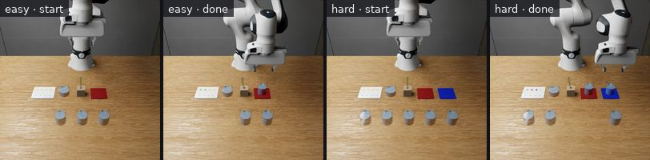

- **Told (seed 0):** easy *"One beaker holds an acid. Put it on the red mat."* · hard *"Put the acid on the red mat and the base on the blue mat."*
- **Hint:** *"A pH strip turns red with an acid and blue with a base."*
- **Missing:** which beaker holds what -- they look the same, only a test tells -- and how the test is done: a strip is never put into a beaker, and the rod is rinsed between them
- **Easy → hard:** beakers and strips: three beakers and four strips, find the acid → five beakers, find the acid and the base, only four strips
- **Success:** the acid on the red mat (and the base on the blue mat), alone there, nothing knocked over
- **Limits:** easy 76 turns, 10 min · hard 100 turns, 13 min
- **Scripted reference on Isaac (seeds 0-24):** easy 25/25 in 46 s · hard 25/25 in 88 s

**DS6 Flame Test** · 1 arm (FR3)

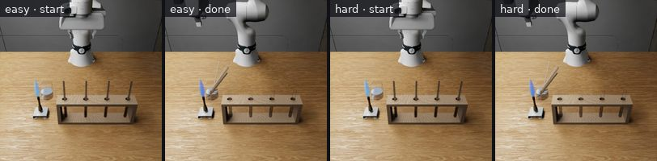

- **Told (seed 0):** easy *"Make the flame green."* · hard *"Make the flame red, then green."*
- **Hint:** *"Each splint has soaked in the solution in its tube. Hold a splint's soaked end in the flame to see the colour it gives; used splints go in the beaker of water."*
- **Missing:** which splint burns which colour -- nothing on the bench says, and only a try in the flame tells
- **Easy → hard:** the flame colours asked for: green → red, then green (two splints, one after the other; a splint that burns green before the red has shown has to be kept for its turn)
- **Success:** the flame each colour asked for, in turn, for 1 s
- **Limits:** easy 88 turns, 12 min · hard 100 turns, 13 min
- **Scripted reference on Isaac (seeds 0-24):** easy 25/25 in 32 s · hard 25/25 in 51 s

### Dynamic interaction (DI)

*What to do is plain; when to do it is decided as the scene changes, and time is short.*

**DI1 Rocket Launch** · 2 arms (ARX X5)

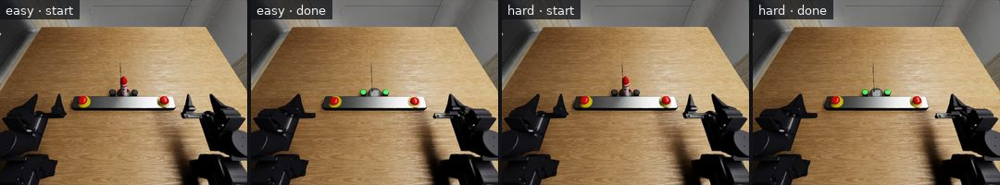

- **Told (seed 0):** *"Launch the rocket."*
- **Missing:** how the launch works: both buttons down together (both lamps lit), and whether they spring back
- **Easy → hard:** whether a pressed button stays down: it locks (one after the other will do) → it springs back (both held down together for 0.5 s)
- **Success:** the rocket has lifted off
- **Limits:** 30 turns, 4 min of simulated time (both levels)
- **Scripted reference on Isaac (seeds 0-24):** easy 25/25 in 11 s · hard 25/25 in 11 s

**DI2 Load the Train** · 1 arm (FR3)

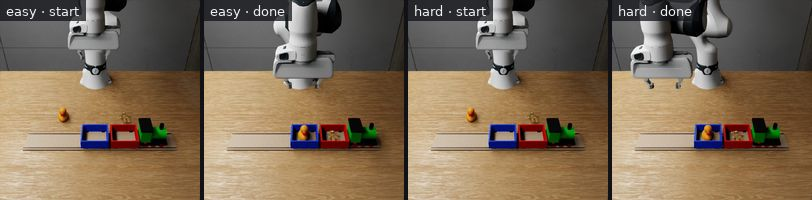

- **Told (seed 0):** *"Put the teddy in the red wagon and the duck in the blue one."*
- **Hint:** *"The train keeps running back and forth along its track. A toy let go over a wagon lands in it."*
- **Missing:** where the wagon will be when the bear is let go
- **Easy → hard:** the train's travel during one T_ref divided by the wagon's spare room (at T_ref = 8 s, 1.1 cm and 18 cm)
- **Success:** the teddy in the red wagon and the duck in the blue one, both still relative to their wagons, for 2 s
- **Limits:** 80 turns, 11 min of simulated time (both levels)
- **Scripted reference on Isaac (seeds 0-24):** easy 25/25 in 17 s · hard 25/25 in 18 s

**DI3 Traffic Light** · 1 arm (FR3)

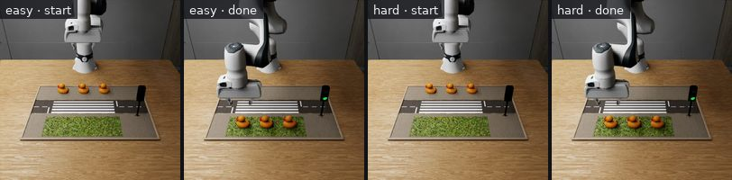

- **Told (seed 0):** *"Take the ducklings across the road to the grass, one at a time. Cross only while the light is green: no duckling on the road when it is red."*
- **Missing:** when the light will change -- the timing does not exist before it happens
- **Easy → hard:** how the light changes, in T_ref (8 s): greens of 2-2.5 T_ref (16-20 s) and reds of 2 T_ref, starting red, and 1 s to get off the road once it turns red → greens of 0.31-0.44 T_ref (2.5-3.5 s; never under 2.5 s, the time the arm needs to carry a duckling across), reds of 3 s and 0.5 s
- **Success:** every duckling on the grass, at rest, one at a time over the road, and none on it once the light had been red for longer than the moment allowed to get off it
- **Limits:** easy 1,296 turns, 30 min · hard 400 turns, 30 min
- **Scripted reference on Isaac (seeds 0-24):** easy 25/25 in 89 s · hard 25/25 in 38 s

**DI4 Simon Says** · 1 arm (FR3) · development task

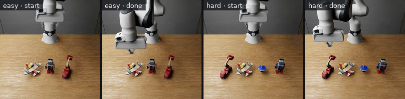

- **Told (seed 0):** *"Let's play Simon says: do what Simon says -- and only that."*
- **Hint:** *"To touch a toy, tap it from above with the closed gripper. Do a Simon call at once -- it stands only until the next call is said, and missing it loses the game."*
- **Missing:** the calls themselves: what each one says, and whether it starts with "Simon says" -- neither exists until it is said
- **Easy → hard:** how the calls come: four, one without "Simon says", 2.5 T_ref apart (20 s at 8 s) → six, two without, 1 T_ref apart (8 s), each bare call right after a call on the same toy; at both levels the first call comes after 2 T_ref, time to look at the toys first
- **Success:** every call with "Simon says" done while it stood, without touching other toys too, and no call without it done
- **Limits:** easy 212 turns, 28 min · hard 148 turns, 20 min
- **Scripted reference on Isaac (seeds 0-24):** easy 25/25 in 96 s · hard 25/25 in 64 s

**DI5 Whack-a-Mole** · 2 arms (ARX X5)

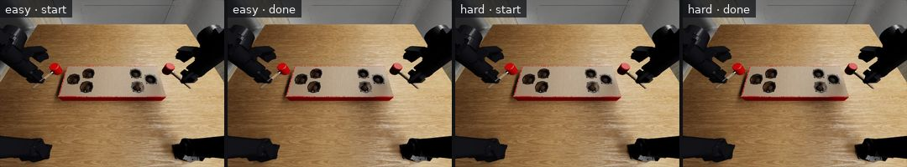

- **Told (seed 0):** *"Whack the moles with the mallets!"*
- **Hint:** *"Each arm reaches only the three holes on its own side. Each mallet lies flat in its hand, the middle of its head 8.6 cm past the grip along the handle, the head 4.7 cm across. A mole counts as whacked when that head comes down onto its top while it is up."*
- **Missing:** where the next mole comes up: it does not exist until it does
- **Easy → hard:** how the moles come up: one at a time, each up 2.5 T_ref (20 s at 8 s) → one on each side at once, up 0.375 T_ref (3 s). At both levels the first comes up 3 T_ref in (24 s)
- **Success:** all the moles but one whacked -- by a held mallet's head coming down on them -- before they go back down, and no more than three swings at empty holes
- **Limits:** easy 580 turns, 30 min · hard 138 turns, 18 min
- **Scripted reference on Isaac (seeds 0-24):** easy 25/25 in 93 s · hard 25/25 in 22 s (v2.3.3, the moles up from 2 s)

**DI6 Dessert Covers** · 1 arm (FR3)

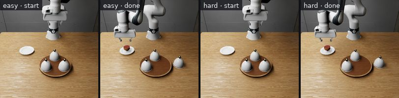

- **Told (seed 0):** *"The cake is under the cover nearest you. Watch the turntable, and when it stops, find the cake and put it on the plate."*
- **Hint:** *"Lift only one cover."*
- **Missing:** where the cake's cover ends up -- it does not exist until the table stops, and only following the cover gives it
- **Easy → hard:** how the table turns: once, a third of the way round in 1.75 T_ref (14 s, 0.15 rad/s at 8 s) → three times, a third in 0.22 T_ref (1.75 s, 1.2 rad/s), back and forth. At both levels the table starts turning 3 T_ref in (24 s)
- **Success:** the cake on the plate, with only one cover lifted and none before the table stopped
- **Limits:** easy 172 turns, 23 min · hard 87 turns, 12 min
- **Scripted reference on Isaac (seeds 0-24):** easy 25/25 in 57 s · hard 25/25 in 42 s (v2.3.3, the table turning from 3 s)

### Contact-rich manipulation (CR)

*What to do is plain; how to do it has to be worked out, and the difficulty is in the contact: fitting, screwing, pushing, pressing, folding.*

**CR1 Shape Sorter** · 1 arm (FR3) · development task

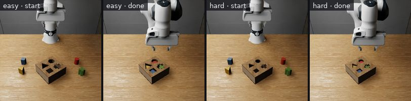

- **Told (seed 0):** *"Put each block into the box through the hole of its own shape."*
- **Hint:** *"The lid is fixed to the box. A block that has gone through a hole cannot be taken out again."*
- **Missing:** how each block has to be turned to go through its hole, and what to do with one that comes to rest on the lid
- **Easy → hard:** the gap between a block and the edge of its hole, all round: 6 mm → 2 mm
- **Success:** all four blocks inside the box and still for 1 s, each having dropped through the hole of its own shape
- **Limits:** 120 turns, 16 min of simulated time (both levels)
- **Scripted reference on Isaac (seeds 0-24):** easy 25/25 in 43 s · hard 25/25 in 43 s

**CR2 Screw the Bulb** · 1 arm (FR3)

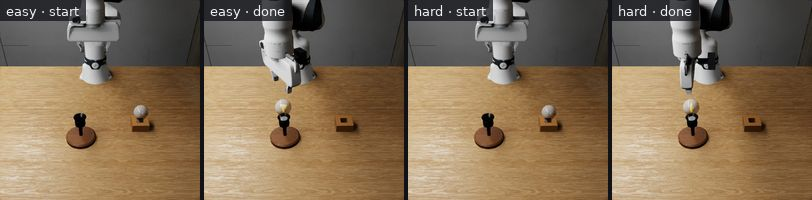

- **Told (seed 0):** *"Screw the light bulb into the lamp."*
- **Hint:** *"The lamp lights up once the bulb is screwed all the way in."*
- **Missing:** how a bulb goes in: which way it turns, and that the wrist cannot make the turns in one go -- turn, let go, turn back, take hold again
- **Easy → hard:** how far the bulb has to be turned in its socket before the lamp lights: a quarter turn → two turns
- **Success:** the lamp lit -- the bulb turned clockwise in its socket by the turns the level asks -- and the bulb let go, standing in the socket (its cap down in the bore), for 2 s
- **Limits:** easy 60 turns, 8 min · hard 120 turns, 16 min
- **Scripted reference on Isaac (seeds 0-24):** easy 25/25 in 17 s · hard 25/25 in 44 s

**CR3 Curling** · 1 arm (FR3)

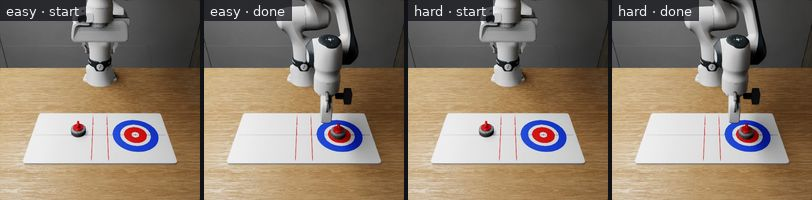

- **Told (seed 0):** easy *"Push the stone into the house."* · hard *"Push the stone onto the button -- the white round in the middle of the house -- so that it covers it."*
- **Hint:** *"The stone may only be pushed along the sheet: never grip it or lift it. It stops where the hand stops pushing."*
- **Missing:** how to move a stone that may not be gripped: from which side to push it, how far, and that a push off its middle sends it sideways
- **Easy → hard:** how far from the middle of the house the stone's middle may come to rest: 9 cm (in the house) → 1.5 cm (covering the button)
- **Success:** the stone at rest for 2 s with its middle inside the zone, still on the sheet, never gripped -- the fingers round it -- (nor squeezed between fingers sent part way closed) and never lifted
- **Limits:** 60 turns, 8 min of simulated time (both levels)
- **Scripted reference on Isaac (seeds 0-24):** easy 25/25 in 7 s · hard 25/25 in 7 s

**CR4 Graphics Card** · 1 arm (FR3)

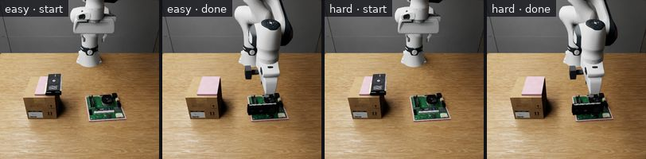

- **Told (seed 0):** *"Fit the graphics card into the long white slot on the motherboard and press it all the way in."*
- **Hint:** *"The card is in when its gold edge is pressed all the way into the slot; the slot holds it there."*
- **Missing:** how to take up a card that lies flat so that it can go in -- level, from the side, by its overhanging edge -- and that it then has to hang gold edge down, be turned to the slot and pressed until it stays
- **Easy → hard:** the play of the card's gold edge in the mouth of the slot, each side: 3 mm → 1 mm (below its mouth the slot narrows to grip the edge)
- **Success:** the card's gold edge at the bottom of the slot, the card standing in it, the hand off it, for 2 s
- **Limits:** 90 turns, 12 min of simulated time (both levels)
- **Scripted reference on Isaac (seeds 0-24):** easy 25/25 in 18 s · hard 25/25 in 19 s

**CR5 Snap the Bricks** · 1 arm (FR3)

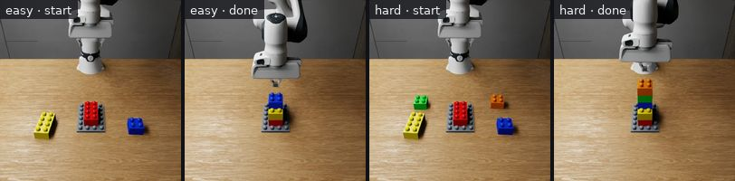

- **Told (seed 0):** easy *"Press the yellow brick onto the red one so that it covers it exactly, and the blue brick onto the middle of the yellow one."* · hard *"Press the yellow brick onto the red one so that it covers it exactly, the blue brick onto the middle of the yellow one, the green brick onto the blue one and the orange brick onto the green one."*
- **Hint:** *"A brick is on only when it is pressed fully down over the studs, and it holds only on a brick that is itself pressed down."*
- **Missing:** how a brick goes on: brought square over the studs within a few millimetres, let down over them and pressed until the gap under it is closed -- and what to do with one that stays up on the studs
- **Easy → hard:** how many bricks there are to add: 2 → 4
- **Success:** every brick over the middle of the one below, square to it and fully down on it, none in the hand and the hand off the tower, for 2 s
- **Limits:** easy 70 turns, 9 min · hard 100 turns, 13 min
- **Scripted reference on Isaac (seeds 0-24):** easy 25/25 in 34 s · hard 25/25 in 65 s

**CR6 Fold the T-Shirt** · 2 arms (ARX X5)

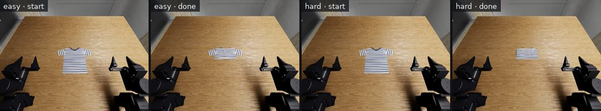

- **Told (seed 0):** easy *"Fold the T-shirt in half: its bottom edge up to its shoulders."* · hard *"Fold the T-shirt: both sleeves in over the front, then its bottom edge up to its shoulders."*
- **Hint:** *"Closing a hand's fingers on the cloth pinches it: the cloth under the fingertips comes with the hand until the fingers open."*
- **Missing:** how a shirt is folded: taken by pinching its edge, a hand to each side, both hands up and round the fold together -- not pushed along the table, not one corner at a time -- and let go where the edge is to lie; and at the hard level which fold comes first
- **Easy → hard:** how many folds are asked for: one (the bottom edge up to the shoulders) → three (each sleeve in first)
- **Success:** the T-shirt lying folded as asked -- its marks on the folded shape's, 8 mm off on average for one fold (8 mm times the square root of the folds asked, for more) and 4 cm at worst, wherever on the table it lies but not mirrored -- no hand on it, for 2 s
- **Limits:** easy 60 turns, 8 min · hard 100 turns, 13 min
- **Scripted reference on Isaac (seeds 0-24):** easy 25/25 in 14 s · hard 25/25 in 36 s
