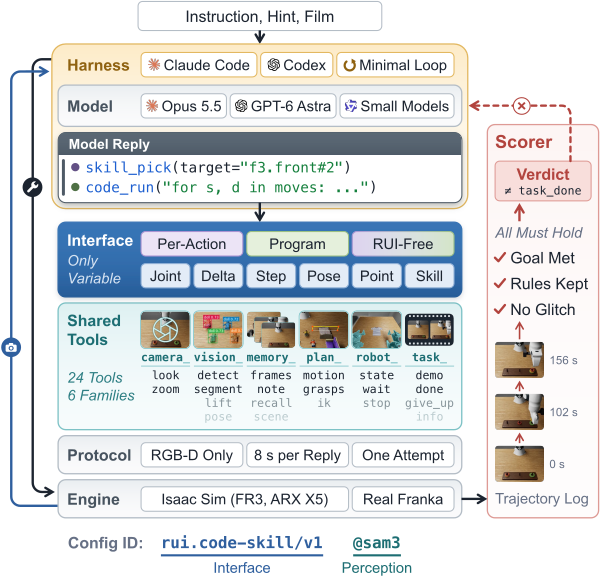

# RUIKit

RUIKit builds the Robot Agents that RUIBench evaluates. A **Robot Agent** is
a model, a Harness, an interface and a perception backend. Each part is
replaceable on its own, so an experiment changes one and keeps the rest.

<div align="center">



</div>

| Part | What it decides | Package | Base class, registry | Implementations |
|---|---|---|---|---|
| Action abstraction | how the arm is told what to do | `ruikit/actions/` | `ActionAbstraction`, `ACTIONS` | joint, delta, step, pose, point, skill |
| Interaction form | how the action tools reach the model | `ruikit/interfaces/` | `Interface`, `FORMS` | per_action, program, free; sequence (the ablation) |
| Harness | how an episode is run: ask the model, run its calls, hand back the results | `ruikit/harness/` | `Harness`, `harnesses()` | minimal loop, Codex, Claude Code |
| Harness component | what the Harness adds: memory, the aids, an operation guide, the observation policy | `ruikit/harness/components/` | `Component`, `COMPONENTS` | memory, marks, pointer, track, grasps, paths, reach, give_up, guide, pull |
| Perception backend | what answers the perception tools | `ruikit/perception/backends/` | `PerceptionBackend`, `BACKENDS` | pixels (`model`), privileged, synthetic |
| Model client | one call to a model, in its endpoint's request format | `ruikit/models/` | `ModelClient` | Chat Completions, Responses |
| Evaluation condition | how thinking is charged; what perception may know | `ruikit/conditions.py` | `Condition` | 8 s a reply, paused, measured; pixels, privileged |

An **interface** is an interaction form applied to an action abstraction.
Six abstractions in two forms make the paper's 12 fixed RUIs; RUI-Free offers
all of them at once: 13 interfaces. Each has a name, as the paper gives it,
and a versioned id (`ruikit/configs/interfaces.yaml`, `ruikit/naming.py`).
The name is what you type and read; the id is what the agent reads in its
prompt and what names a result's folder. A name runs the RUI as the paper
did, with the aids: `program-skill` is `rui.code-skill/v1+aids`.

| Abstraction | Per-action: name · id | Program: name · id | Action sequence (ablation): name · id |
|---|---|---|---|
| Joint | `joint` · `rui.joint/v1` | `program-joint` · `rui.code-joint/v1` | `sequence-joint` · `rui.seq-joint/v1` |
| Delta | `delta` · `rui.delta/v1` | `program-delta` · `rui.code-delta/v1` | `sequence-delta` · `rui.seq-delta/v1` |
| Step | `step` · `rui.step/v1` | `program-step` · `rui.code-step/v1` | `sequence-step` · `rui.seq-step/v1` |
| Pose | `pose` · `rui.pose/v1` | `program-pose` · `rui.code/v1` | `sequence-pose` · `rui.seq-pose/v1` |
| Point | `point` · `rui.point/v1` | `program-point` · `rui.code-point/v1` | `sequence-point` · `rui.seq-point/v1` |
| Skill | `skill` · `rui.skill/v1` | `program-skill` · `rui.code-skill/v1` | `sequence-skill` · `rui.seq-skill/v1` |

RUI-Free (`rui-free` · `rui.free/v1`) offers every abstraction's tools side
by side and lets the model choose one each time. The action sequence is the
paper's ablation variant, not one of the 13. An interface id composes
components and a perception setting onto a named interface. For example,
`rui.pose/v1+aids@owlv2-sam2` is pose with the aids, perceiving with OWLv2
and SAM 2.1 ([interfaces.md](interfaces.md)).

## Quick start

```python
import ruikit

agent = ruikit.Agent(model="openai:<model>", harness="minimal-loop",
                     interface="program-pose")                           # the RUI, with its aids
ruikit.run(agent, task="CL2", level="easy", seed=3)                      # the main setting
ruikit.run(agent, task="CL2", level="easy", seed=3, condition="paused")  # thinking costs nothing
```

Each `run` writes one cell of the shared results layout and returns its
result row ([experiments.md](experiments.md)). An episode can also be driven
by hand, one tool call at a time:

```python
from ruikit import Episode

ep = Episode("WK1", level="easy", seed=0, profile="rui.pose/v1", engine="mock")
frame = ep.call("camera_look", {"cameras": ["front"]}).data["frames"][0]["frame_id"]
rings = ep.call("vision_detect", {"frame_id": frame, "query": "ring"}).data["objects"]
...
ep.call("task_done", {"report": "tower moved"})
print(ep.outcome)            # judged from the physical trajectory
ep.close()
```

The mock engine renders no pictures, so a test double stands in for
perception there, and its results never count. Pass `engine="isaac"`, with
the vision service running, for a measurement. `examples/ruikit/` has these
as scripts, along with a tool and an interface added from outside the library.

```bash
ruikit tools                       # every tool, by its place in the design space
ruikit design                      # abstractions, forms, components and their implementations
ruikit interfaces                  # the 13 RUIs by name and id, and the rest
ruikit interface pose --format anthropic --strict                # a provider's tool schemas
ruikit check                       # contract checks of every tool and interface
ruikit episode --task WK1 --interface pose --model openai:<model> # one episode
ruikit run --plan paper --agent claude-code --form program       # a plan's episodes, by setting
ruikit coverage --task WK1         # can each interface's tools do the task at all?
ruikit serve-mcp --task WK1 --interface pose                     # one episode over MCP
```

## Three rules

The episode enforces three rules on the server, not in a prompt.

1. **Information only from sensors.** A tool computes its output from the
   frames the agent's cameras took (picture and depth), the robot's own
   readings (hand pose, finger opening, joint angles), the agent's arguments
   and the public task text.
   - It never uses the simulator's state, not even with noise added. It never
     uses the scorer, the seed or internal object names.
   - Whether the hand holds something is read from the fingers: closed, and
     stopped at least 2 mm apart.
   - The privileged control condition is the one exception. It is asked for by
     name, and every log records it.
2. **Actions only through the controller.** Everything that changes the
   world goes through the shared executor and its limits. No tool sets state,
   teleports, applies a force or resets.
3. **Everything costs time.** Every call advances the simulated clock, and
   the world moves while the model thinks.

## The episode

`ruikit.env.Episode` holds one run on the server side: the task on one
engine, the clock, the budget, the log.

- **Clock.** The simulation is paused between calls. When a call arrives, the
  world first advances by the model's thinking time, then the call runs. The
  condition decides the thinking time ([experiments.md](experiments.md)).
- **Replies.** `ep.call_batch([...])` is one reply. Motions on different arms
  run together, and the reply returns when every blocking motion in it has
  finished. A per-action interface takes one action per arm per reply.
- **Handles.** A motion with `wait=false` returns a handle at once. A
  blocking motion returns after at most 20 s of simulated time.
- **Results** carry the events since the previous call, the simulated time and
  the budget left. A reply that moved an arm also carries every camera's
  picture, unless the interface has `+pull`.
- **The end.** `task_done`, `task_give_up` or a budget ends the episode.
  Success comes from the task's predicates on the physical trajectory,
  audited for impossible physics.
- **Logs.** With `log_dir`, an episode writes `{stem}.jsonl` (every call, its
  arguments and results) and `{stem}.episode.jsonl` (the benchmark's
  `ruibench-log/2` record). `ruibench rescore {stem}.episode.jsonl` judges the
  run again from that file alone.

Every episode has two limits, taken from the task's model-call budget unless
the budget sets them:
- **replies:** `max_model_calls × 10` top-level calls or batches;
- **simulated time:** `max_model_calls × 8 s`, never more than the benchmark's
  cap of 1,800 s.

## Enforced, not remembered

| Rule | Where |
|---|---|
| Provider-legal names, real descriptions, strict schemas, valid examples. | `core/tool.py` at registration; `ruikit check` |
| Every tool has one place in the design space. An interface is the shared tools and one abstraction's. A composed id says what it attached. | `interfaces/roles.py`, `ruikit check`; `tests/ruikit/interfaces/test_design_space.py`, `test_interface_ids.py` |
| No tool reads the simulator where pictures are rendered. Holding is told by the fingers. Perception is never better than a real robot's. | `perception/backends/`, `env/context.py`; `tests/ruikit/perception/test_pixels.py` |
| Tools never import the world's internals or reach past `ctx`. | `core/check.py` |
| A program over an abstraction calls exactly what its per-action interface offers. | `interfaces/program.py`; `tests/ruikit/core/test_contract.py` |
| The aids add no way of moving the arm and no other model. A description names only tools on offer. | `tests/ruikit/harness/components/test_aids.py` |
| An agent over MCP has the session's tools only, one call a reply. | `serve/mcp_stdio.py`, `serve/session.py`; `tests/ruikit/serve/test_session_mcp.py` |
| Hidden things are not reported. Ids are frame-local. The same question gets the same answer. | `tests/ruikit/perception/test_synthetic.py` |
| Stopped motions and sessions never resume. | `tests/ruikit/env/test_episode.py` |
| Programs run online, confined and charged. Custom tools gain no powers. | `interfaces/sandbox/`; `tests/ruikit/interfaces/test_sandbox.py` |
| No result carries a task secret; a leak voids the run. | `env/episode.py`; `tests/ruikit/env/test_secrets.py` |
| A run is judged again from its log alone, with the same verdict. | `tests/ruikit/env/test_episode.py` |

## The tool library

The library has 49 tools, grouped by their place in the design space (the
paper's 24 are those every RUI offers). ✓ means
the interface offers the tool; the program interface calls its tools from
inside the program.
- A component's or an extra's tools are in no base interface; `+name` attaches
  them to any.
- "An aid" marks the tools that `+aids` attaches. RUI-Free has them built in.
- "Not offered" marks tools that need something this benchmark does not have:
  a world model, or a fine-tuned policy.

<details>
<summary>All 49 tools, and which interface offers each</summary>

| Place | Tool | What it does | Joint | Delta | Step | Pose | Point | Skill | Program | Free | Open |
|---|---|---|:-:|:-:|:-:|:-:|:-:|:-:|:-:|:-:|:-:|
| shared by every interface | `camera_look` | take pictures now with one or more cameras | ✓ | ✓ | ✓ | ✓ | ✓ | ✓ | ✓ | ✓ | ✓ |
|  | `camera_zoom` | enlarge part of a picture (no new detail) | ✓ | ✓ | ✓ | ✓ | ✓ | ✓ | ✓ | ✓ | ✓ |
|  | `robot_state` | each arm's gripper pose and finger opening, and whether the fingers stopped on something | ✓ | ✓ | ✓ | ✓ | ✓ | ✓ | ✓ | ✓ | ✓ |
|  | `vision_detect` | the things in a picture: box, outline, word, score, colour | ✓ | ✓ | ✓ | ✓ | ✓ | ✓ | ✓ | ✓ | ✓ |
|  | `vision_segment` | one thing's outline, from a word, a point or a box | ✓ | ✓ | ✓ | ✓ | ✓ | ✓ | ✓ | ✓ | ✓ |
|  | `vision_lift` | a pixel to a 3-D point, from the picture's depth | ✓ | ✓ | ✓ | ✓ | ✓ | ✓ | ✓ | ✓ | ✓ |
|  | `vision_pose` | a thing's position, heading, tilt and size, from its outline and depth | ✓ | ✓ | ✓ | ✓ | ✓ | ✓ | ✓ | ✓ | ✓ |
|  | `robot_wait` | let the world run: some seconds, until motions end, or until the next event | ✓ | ✓ | ✓ | ✓ | ✓ | ✓ | ✓ | ✓ | ✓ |
|  | `robot_stop` | stop a motion now | ✓ | ✓ | ✓ | ✓ | ✓ | ✓ | ✓ | ✓ | ✓ |
|  | `task_info` | the instruction, the hint, the arms, cameras and conventions | ✓ | ✓ | ✓ | ✓ | ✓ | ✓ | ✓ | ✓ | ✓ |
|  | `task_demo` | the films shown before the episode | ✓ | ✓ | ✓ | ✓ | ✓ | ✓ | ✓ | ✓ | ✓ |
|  | `task_events` | what has happened so far: a changed instruction, a toy answering | ✓ | ✓ | ✓ | ✓ | ✓ | ✓ | ✓ | ✓ | ✓ |
|  | `task_done` | say the task is done (success is judged from what happened) | ✓ | ✓ | ✓ | ✓ | ✓ | ✓ | ✓ | ✓ | ✓ |
| action abstractions | `robot_solve_ik` | joint angles for a gripper pose: the robot's own inverse kinematics | ✓ |  |  |  |  |  |  | ✓ | ✓ |
|  | `robot_move_joints` | move the arm's joints to target angles | ✓ |  |  |  |  |  |  | ✓ | ✓ |
|  | `robot_gripper` | open or close the fingers | ✓ | ✓ |  | ✓ | ✓ | ✓ | ✓ | ✓ | ✓ |
|  | `robot_move_delta` | move the gripper by a vector and a turn from where it is |  | ✓ |  |  |  |  |  | ✓ | ✓ |
|  | `robot_step` | one fixed-size step: a direction, a turn, grasp or release (up to 5 at once) |  |  | ✓ |  |  |  |  | ✓ | ✓ |
|  | `robot_move_to` | move the gripper to a position and orientation |  |  |  | ✓ |  |  | ✓ | ✓ | ✓ |
|  | `robot_move_to_pixel` | move the gripper to a point picked in a picture |  |  |  |  | ✓ |  |  | ✓ | ✓ |
|  | `skill_pick` | pick a thing up: open, come down from above (or level, from the side), grip, lift |  |  |  |  |  | ✓ |  | ✓ | ✓ |
|  | `skill_place` | put down what the hand holds |  |  |  |  |  | ✓ |  | ✓ | ✓ |
|  | `skill_press` | press, tap or strike from above |  |  |  |  |  | ✓ |  | ✓ | ✓ |
|  | `skill_push` | push a thing along the table |  |  |  |  |  | ✓ |  | ✓ | ✓ |
|  | `skill_move` | bring the hand over a thing or to a point, with what it holds |  |  |  |  |  | ✓ |  | ✓ |  |
|  | `skill_turn` | turn the hand where it is (screwing), or tip it |  |  |  |  |  | ✓ |  | ✓ |  |
| interaction forms | `code_run` | run a Python program that calls the tools |  |  |  |  |  |  | ✓ | ✓ | ✓ |
| Harness components | `memory_note` | write a note for later in the episode (component `+memory`; an aid) |  |  |  |  |  |  |  | ✓ | ✓ |
|  | `memory_recall` | read the notes back (component `+memory`; an aid) |  |  |  |  |  |  |  | ✓ | ✓ |
|  | `memory_frames` | show again pictures taken earlier (component `+memory`; an aid) |  |  |  |  |  |  |  | ✓ | ✓ |
|  | `memory_scene` | what the perception tools found this episode, and where (component `+memory`; an aid) |  |  |  |  |  |  |  | ✓ |  |
|  | `vision_marks` | numbered marks drawn on a copy of a picture (dots, outlines or boxes; or a grid) (component `+marks`; an aid) |  |  |  |  |  |  |  | ✓ | ✓ |
|  | `vision_point` | a pixel on the thing a description names (the detector, or a vision-language model) (component `+pointer`; an aid) |  |  |  |  |  |  |  | ✓ | ✓ |
|  | `vision_track` | keep following one thing: its position and speed (component `+track`; an aid) |  |  |  |  |  |  |  | ✓ | ✓ |
|  | `plan_grasps` | grasps for a thing, from its measured points (component `+grasps`; an aid) |  |  |  |  |  |  |  | ✓ | ✓ |
|  | `plan_motion` | a path round what the cameras saw (component `+paths`; an aid) |  |  |  |  |  |  |  | ✓ | ✓ |
|  | `plan_ik` | can the arm reach this point? (component `+reach`; an aid) |  |  |  |  |  |  |  | ✓ | ✓ |
|  | `task_give_up` | give up, saying why (component `+give_up`; an aid) |  |  |  |  |  |  |  | ✓ |  |
| extras, outside the design space | `model_ask` | ask a second vision-language model about some pictures (extra `+ask`) |  |  |  |  |  |  |  |  | ✓ |
|  | `model_decide` | quick typed decisions from a small or general model (extra `+decide`) |  |  |  |  |  |  |  |  | ✓ |
|  | `robot_waypoints` | go through up to 12 waypoints (extra `+motion`) |  |  |  |  |  |  |  |  | ✓ |
|  | `robot_chunk` | play a short open-loop chunk of small moves (extra `+motion`) |  |  |  |  |  |  |  |  | ✓ |
|  | `robot_home` | back to the start pose (extra `+motion`) |  |  |  |  |  |  |  |  | ✓ |
|  | `toolkit_define` | define a new tool from the existing ones, for this episode (extra `+make`) |  |  |  |  |  |  |  |  | ✓ |
|  | `toolkit_list` | list the tools this interface offers (extra `+make`) |  |  |  |  |  |  |  |  | ✓ |
|  | `toolkit_remove` | remove a tool defined with toolkit_define (extra `+make`) |  |  |  |  |  |  |  |  |  |
|  | `model_imagine` | predict the next pictures with a world model (not offered) |  |  |  |  |  |  |  |  | ✓ |
|  | `policy_run` | hand an arm to a vision-language-action policy (not offered) |  |  |  |  |  |  |  |  | ✓ |
|  | `policy_propose` | the policy's next chunk of moves, without running it (not offered) |  |  |  |  |  |  |  |  | ✓ |

</details>

The perception tools read the pictures and the depth, so their estimates
carry a real robot's error: a few millimetres, up to 1-2 cm through the far
camera, and several centimetres without a depth camera. No tool returns an
exact position.

## More

- [interfaces.md](interfaces.md): the interaction forms, the action abstractions, the components and the aids, and composing an id.
- [perception.md](perception.md): perception from pixels, its settings and accuracy; the privileged control.
- [experiments.md](experiments.md): models, conditions, plans, the results layout, the ready-made agents, tool-solvability.
- [extending.md](extending.md): adding a tool, an abstraction, a form, a component, a backend, a model channel or a Harness.
