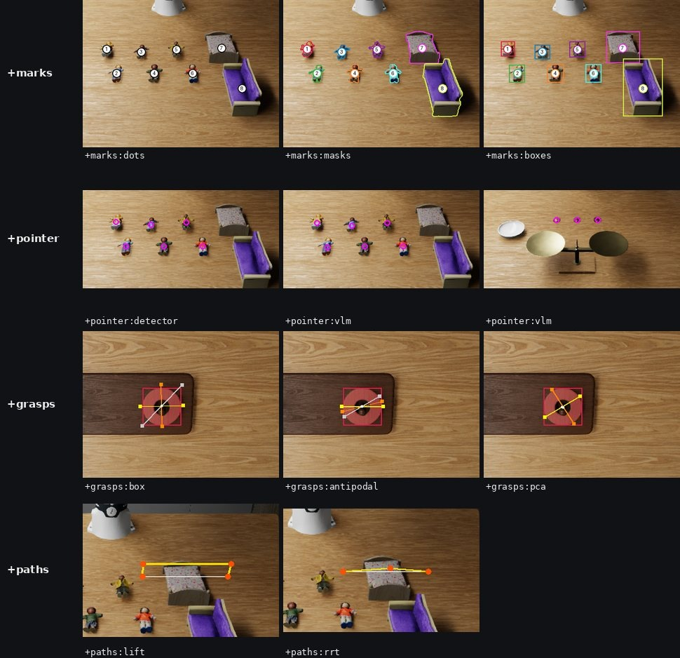

# Interfaces

An interface is an interaction form applied to an action abstraction. The
abstraction decides how the arm is told what to do. The form decides how its
tools reach the model, and so which tools are offered, what a program may
call, the channel the model speaks in, and when control comes back.

The paper's 13 RUIs are the six abstractions in the per-action form (named by
the abstraction: `joint` ... `skill`), the same six in the program form
(`program-joint` ... `program-skill`) and RUI-Free (`rui-free`). Each name has
a versioned id, which is what the agent reads in its prompt and what names a
result's folder: `program-skill` is `rui.code-skill/v1`, and the program over
the pose is `rui.code/v1`. A name runs the RUI with the aids, as the paper
did (`program-skill` runs `rui.code-skill/v1+aids`); an id runs exactly as
written. `ruikit interfaces` lists them ([the README](../../README.md#-ruikit-13-robot-use-interfaces)).

## Shared tools

Every interface offers the same 13 tools:

| Group | Tools |
|---|---|
| sensing | `camera_look`, `camera_zoom`, `robot_state`, `vision_detect`, `vision_segment`, `vision_lift`, `vision_pose` |
| control | `robot_wait`, `robot_stop` |
| task | `task_info`, `task_demo`, `task_events`, `task_done` |

## Action abstractions

| Abstraction | Tools | Published counterpart |
|---|---|---|
| joint | `robot_solve_ik`, `robot_move_joints`, `robot_gripper` | joint targets (Inspect Robots, yad-use) |
| delta | `robot_move_delta`, `robot_gripper` | a move by a vector (Embody's direct control) |
| step | `robot_step` | semantic action tokens (Show-Harness, RT-H) |
| pose | `robot_move_to`, `robot_gripper` | an absolute gripper pose (Robocurve, Inspect Robots) |
| point | `robot_move_to_pixel`, `robot_gripper` | a pixel lifted by depth (Gemini Robotics-ER, MOKA, PIVOT) |
| skill | `skill_pick`, `skill_place`, `skill_press`, `skill_push`, `skill_move`, `skill_turn`, `robot_gripper` | parameterised skills (SayCan, ROS-MCP) |

An abstraction may fix settings of its tools for every interface over it. The
step abstraction fixes its step sizes: 0.25, 1 and 4 cm, and 2, 5 and 15
degrees (`STEP_SIZES` in `ruikit/actions/step.py`).

**The joints.**
- `robot_solve_ik` gives the angles that put the gripper at a pose. It uses
  the robot's own inverse kinematics, inside the joint limits, starting from
  the present joints.
- `robot_move_joints` takes those angles, in degrees, from base to wrist. Every
  joint moves at a shared speed and all arrive together.
- The kinematics are measured on Isaac (`ruibench/engines/kinematics.py`): a
  product of exponentials whose forward map matches the simulator to 0.001 mm.

**The ARX X5's ceiling.** On the two-arm station the X5 holds its hand
pointing down only lower the farther out it reaches: about 17 cm above the
table up to 30 cm from its base, and 7.5 cm at 47 cm (`Station.ceiling`).
The tools respect this limit:
- The skills hover and lift under it.
- `skill_move` and `skill_place` refuse a goal above it.
- `plan_motion` keeps its paths under it.
- `plan_ik` reports it as `ceiling_m`.

## Interaction forms

| Form | Tools offered | A program may call | Channel | Control comes back |
|---|---|---|---|---|
| `per_action` | the shared tools and the abstraction's | -- | tool calls | when the action ends (each step, for the step abstraction) |
| `program` | `code_run` and the task's tools | exactly what the per-action interface over the same abstraction offers | code | when the program ends |
| `free` | the shared tools, every abstraction's tools, `code_run`, the aids | everything but `code_run` and giving up | tool calls | when the action ends |
| `sequence` (the paper's ablation) | the shared tools and `code_run` | the abstraction's action tools, `robot_wait` and `robot_stop`, each returning nothing | tool calls | when the program ends |

**Per-action.** The model calls the action tools itself, one action per arm
per reply (two arms may act together). `robot_wait` blocks until it is done,
so a reply that waits and then acts again is refused. Chaining actions in one
reply is what the program form is for.

**Program.** `code_run` runs Python in a sandboxed process
(`ruikit/interfaces/sandbox/`). The program has no network and no view of
the repository. Each function call in the program is a real tool call,
answered by the episode while the program runs, so a program that moves and
then looks sees the world after the move. The program's own compute time is
charged to the simulated clock. A program over an abstraction and the
per-action interface over it differ only in how the model speaks and in when
control comes back.

**Action sequence** (`sequence-delta` · `rui.seq-delta/v1`, over each
abstraction). The model calls `code_run` with a program that only acts: each
call runs its action and returns nothing, so the program sees nothing in
between, and looking happens between programs, as in the per-action form. It
tells a program's gain from deciding less often from its gain from reading
the world inside the program. It is not one of the 13.

**Free** (RUI-Free, `rui-free` · `rui.free/v1`). Every abstraction's tools are offered at
once, and the model picks one each time:
- the moves: joints, a vector, a step, a pose, a pixel;
- the gripper they share;
- the skills;
- a program.

The aids come with it, and what the aids leave out is left out here too.
Each tool behaves as in its own interface: the same step sizes, one action
per arm per reply.

**The open track** (`open/v1`) lists most of the library, skills and programs
included. It is not part of the design space's comparison.

## Harness components



A component attaches to any interface after a `+`, in one of its
implementations. When the implementation is left out, the default (marked *)
is used. Each implementation is a variable an ablation can change on its own.

| Component | Implementations | Tools |
|---|---|---|
| `memory` | `interleaved`*, `text`, `image`, `scene` | `memory_note`, `memory_recall`, `memory_frames`, `memory_scene` |
| `marks` | `dots`*, `masks`, `boxes` | `vision_marks` |
| `pointer` | `detector`*, `vlm/<route>` | `vision_point` |
| `track` | `redetect`*, `template` | `vision_track` |
| `grasps` | `box`*, `antipodal`, `pca` | `plan_grasps` |
| `paths` | `lift`*, `rrt` | `plan_motion` (the path is followed with the interface's own moves) |
| `reach` | -- | `plan_ik` |
| `give_up` | -- | `task_give_up` |

Two more components change the Harness rather than the tools:
- **The observation policy.** By default, a reply that moved an arm comes back
  with every camera's picture. `+pull` leaves looking to the agent.
- **The operation guide.** `+guide` adds general practice, the same for every
  task, to what the agent is told (`ruikit/configs/guides/manipulation.md`).
  `+guide:<name>` adds another guide.

Every implementation reads only what the shared tools read: pictures, depth,
the robot's readings. The planners plan from what the depth saw. They keep
only the gripper's column clear, and they take what no camera saw as free.

**The aids.** `+aids` attaches every component that helps the agent
remember, see, find, follow and plan, each in its default implementation.
`+aids-<group>` takes one group away:

| Group | Components |
|---|---|
| `memory` | memory |
| `marks` | marks |
| `pointer` | pointer (the detector's) |
| `track` | track |
| `plan` | grasps, paths, reach |

`give_up` stays in every variant. An interface with no aids is its own id.

The aids add no new way of moving the arm and no other model's answer. With
the aids, an interface still moves the arm only as it does alone, and a
model's score stays its own. In a program interface the aids are functions
the program calls.

## Extras

Extras are tools outside the design space. They attach like components, and
they are never part of the aids.

| Extra | Implementations | Tools |
|---|---|---|
| `motion` | -- | `robot_waypoints`, `robot_chunk`, `robot_home` |
| `make` | -- | `toolkit_define`, `toolkit_list`, `toolkit_remove` |
| `ask` | a model route (`ASK_ROUTES` in `ruikit/extras/backends/routes.py`) | `model_ask` |
| `decide` | a model route, or `jev` | `model_decide` |
| `imagine` | not offered: no world model conditioned on the robot's moves | `model_imagine` |
| `policy` | not offered: it would need a policy fine-tuned for these robots | `policy_run`, `policy_propose` |

An extra whose tools are open-track only, such as a second model, makes the
interface an open-track one.

## Composing an id

```text
rui.pose/v1+marks:masks+memory      two components: marks drawn as outlines; all of memory
rui.code/v1+grasps:antipodal        a program may call plan_grasps (the antipodal planner)
rui.point/v1+pointer:vlm/<route>    pointing by a vision-language model instead of the detector
rui.pose/v1+aids-memory             the aids less memory
rui.pose/v1+aids@owlv2-sam2         the aids; perception by OWLv2 + SAM 2.1
rui.pose/v1@depth=mono,noise=2      depth from the RGB picture alone; depth noise doubled
rui.pose/v1+aids@privileged         the control condition: the simulator's own values
```

The id is kept as written, with defaults left out (`+marks` is
`+marks:dots`), so every log says what was attached. On a program interface
a component's tools go to what the program may call. `toolkit_*` and the
task's tools stay with the model.

`ruikit.load_profile(id)` resolves an id into the `Profile` that a Harness
hands to the model and that every log records as its header.

## An interface of your own

An interface can also be a YAML file listing its tools. It may extend a
named interface or take a program's tools from one:

```yaml
id: my.interface/v1
extends: rui.pose/v1                 # or list everything below yourself
title: "pose, and an echo"
tools: [camera_look, robot_state, vision_detect, robot_move_to, robot_gripper,
        robot_wait, robot_stop, task_info, task_demo, task_events, task_done, my_echo]
params:
  perception: {backend: sam3, depth: sensor}
```

`code_from: rui.step/v1` gives a code-channel interface the tools of another
as its program's functions. Loading checks every name and every tool's
track. `load_profile("path/to/file.yaml+aids")` composes onto a file, too.
