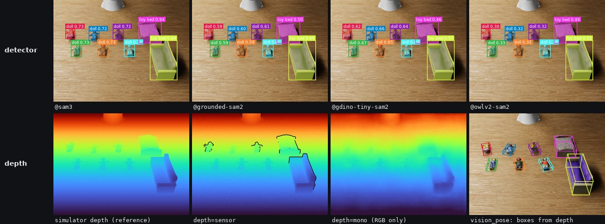

# Perception

The perception tools are `vision_detect`, `vision_segment`, `vision_lift` and
`vision_pose`, plus the components built on them. A perception backend
answers them (`ruikit/perception/backends/`):

| Backend | `perception` | When |
|---|---|---|
| pixels | `model` | wherever pictures are rendered: the only measured condition |
| privileged | `privileged` | the control condition, asked for by name (`@privileged`) |
| synthetic | `synthetic` | the mock engine, which renders no pictures: a test double whose results never count |

## From pixels



*Over 100 marked frames, SAM 3 finds 93% of the things and places them within
0.5-0.7 cm. From the RGB alone, about 70% are found, with about three times
the error ([docs/ruikit/perception.md](perception.md)).*

The backend answers from nothing but what an RGB-D camera delivers (the
picture and a depth image) and what the robot knows of itself (its camera
calibration and its joint readings). It reads no position, no name and no
segmentation from the simulator. Asking for `synthetic` where pictures are
rendered is refused.

**Settings**, after the `@` of an interface id (`ruikit/perception/settings.py`):

| Setting | Values (default first) | What it is |
|---|---|---|
| detector | `sam3`, `grounded-sam2`, `gdino-tiny-sam2`, `owlv2-sam2` | SAM 3 alone, or a box detector (Grounding DINO base or tiny, OWLv2 large) with SAM 2.1 for the masks |
| `depth=` | `sensor`, `mono` | the depth camera; or the RGB picture alone, depth predicted by Depth Anything V2 and fitted to the table top the robot knows |
| `noise=` | 1, 2, 4 | the depth camera's noise, as a multiple of a real one's |
| `calib=` | 1, 2, 4 | the camera calibration's error, as a multiple of a real robot's |

These settings can only make perception worse, never better than a real
robot's. A more exact perception would hand the agent positions it could not
have.

**How a question is answered.**
- *Detect, point, segment by text.* SAM 3 finds every instance of the agent's
  words and outlines each, one phrase per pass. An empty query asks for the
  task's public category words and for any "object". Every answer carries the
  model's score, from 0.2 up; the tool calls an answer under 0.5 doubtful.
- *Segment at a pixel or in a box.* The same weights, prompted.
- *What is turned away.* A detection that depth says is not a thing on the
  table: the robot's own hand, wrist and base (where its joint readings put
  them), the table top, what lies below it, and slivers at the picture's edge.
- *Pose.* The mask's pixels are lifted by depth into a box standing on what is
  under the thing. The pose is the middle of its footprint, the heading of its
  longer side, and its extent. Only the side the camera sees is measured.
- *Lift.* The depth at the pixel.
- *Errors.*
  - The camera calibration is off by 3 mm and 0.3 degrees, the same draw for
    the same seed.
  - Depth noise is 1 mm plus 0.3 % of the distance, per pixel.
  - The rest is the model's own: a thing missed, two merged, a wrong word, a
    mask cut short.

**The vision service.** The models run in their own process, apart from the
simulator (about 6.5 GB of GPU memory for SAM 3):

```bash
CUDA_VISIBLE_DEVICES=<card> python -m ruikit.perception.service.server            # SAM 3, port 18300
python -m ruikit.perception.service.server --backend owlv2-sam2 --port 18302 --depth dav2-small
```

- One server answers one detector. `--depth dav2-small` also loads the
  monocular depth model, for `depth=mono`.
- `RUIKIT_VISION_URL` tells episodes where the servers are. Several addresses,
  comma separated, are copies of one server. Each process keeps one, so
  episodes running side by side spread over the copies.
- An episode asks the server which model it runs before the episode starts,
  and stops there if none is running or it runs another backend. The name and
  revision go into the episode's log.
- The weights are pinned by revision (`ruikit/perception/service/models.py`).
  `facebook/sam3` is gated on Hugging Face: download it once with `HF_TOKEN`
  set; after that the server starts from the cache.

## How well it reads a scene

The measurements are on Isaac, over 100 frames:
- the four development tasks, easy level, spare seeds 35-39;
- the fixed camera, the wrist camera at the start, and the wrist camera 22 cm
  above a thing.

"Found" means found with an empty query. The errors are medians of the
horizontal and the vertical distance to the thing's true middle, given for
the fixed camera / the wrist cameras.

| Detector | Depth, errors | Found | Under its own word | Horizontal error | Height error |
|---|---|---|---|---|---|
| `sam3` | depth camera | 452 of 488 | 296 | 0.65 / 0.48 cm | 0.49 / 0.29 cm |
| `sam3` | RGB only | 336 of 488 | 224 | 1.86 / 0.93 cm | 0.85 / 0.74 cm |
| `grounded-sam2` | depth camera | 416 of 488 | 369 | 0.68 / 0.50 cm | 0.52 / 0.29 cm |
| `grounded-sam2` | RGB only | 300 of 488 | 257 | 1.92 / 1.03 cm | 0.69 / 0.64 cm |
| `gdino-tiny-sam2` | depth camera | 416 of 488 | 350 | 0.68 / 0.50 cm | 0.51 / 0.31 cm |
| `gdino-tiny-sam2` | RGB only | 303 of 488 | 246 | 1.80 / 1.17 cm | 0.77 / 0.69 cm |
| `owlv2-sam2` | depth camera | 443 of 488 | 244 | 0.67 / 0.50 cm | 0.53 / 0.29 cm |
| `owlv2-sam2` | RGB only | 336 of 488 | 195 | 1.97 / 1.09 cm | 0.77 / 0.82 cm |
| `sam3` | depth noise ×2 | 451 of 488 | 295 | 0.71 / 0.48 cm | 0.46 / 0.31 cm |
| `sam3` | depth noise ×4 | 437 of 488 | 281 | 0.66 / 0.51 cm | 0.42 / 0.34 cm |
| `sam3` | calibration ×2 | 452 of 488 | 296 | 1.25 / 0.87 cm | 0.81 / 0.53 cm |
| `sam3` | calibration ×4 | 452 of 488 | 296 | 2.63 / 1.68 cm | 1.55 / 1.01 cm |

- **Where things are** is decided by the outline and the depth, not the
  word: every detector places what it finds within 0.5-0.7 cm.
- **The detectors differ** in what they find and under which word: SAM 3
  finds the most, and Grounding DINO names best.
- **Without a depth camera**, a third of the things are lost, and the errors
  triple. The lost things are small ones, which predicted depth cannot tell
  from the table.
- **A worse calibration** moves everything with it.

**The word, not the place.** SAM 3 takes "X piece" and "O piece" for one kind
of thing, and "stand" or "balance pan" mean little to it. A plainer phrase
settles each, and an agent is free to use one. The score tells a phrase that
fits from one that does not:

| Asked as | Finds | Other things returned |
|---|---|---|
| "red cross" | X pieces, 100 of 100 | 18 |
| "blue ring" | risen O pieces, 20 of 20 | 46 (5 scored 0.5 or more) |
| "wooden board" | the stand, 25 of 25 | 0 |
| "scale pan" | the pans, 10 of 10 | 5 |
| "colored ring" | Hanoi rings, 46 of 59 | 1 |
| "gold disc" | coins, 65 of 75 | 15, the pans among them |

**Not covered.**
- Frames from the middle of an episode.
- See-through things: the renderer's depth stops at the glass, while a real
  depth camera's does not.
- Things flatter than a few millimetres, which a far depth camera cannot tell
  from the table.
- Things stacked or touching, which the model may take as one.

## The privileged control

`@privileged` makes every perception tool and component answer with the
simulator's own values:
- where each thing is, how it is turned and how big it is;
- the cameras' poses;
- on Isaac, each thing's pixels, from the renderer's segmentation.

What a picture shows is still what its camera sees. The condition is asked
for by name and is never a default. The episode's log records it
(`condition: privileged`). The grasp audit counts the offset owed to
perception as zero. The control offers no success check: what the lack of one
costs is measured by how often agents say they are done and fail.
